# 模型校核图册

> 本册全部配图按原记录区分项目模型截图与外部资料。2026-11-14 文档重整未生成新截图，也未把旧图升级为当前发布验收。各节的构建、测试和页面结论属于各自历史轮次；本轮验证见 [进度记录](../../progress.md)。

内容索引

- [2026-11-14 · 天安门外金水桥与端门比例续修](#2026-11-14--天安门外金水桥与端门比例续修)
- [2026-11-14 · 城门上层柱脚衔接](#2026-11-14--城门上层柱脚衔接)
- [2026-11-14 · 城门上层房身整体衔接续修](#2026-11-14--城门上层房身整体衔接续修)
- [2026-11-14 · 城门柱墙与瓦面自然衔接](#2026-11-14--城门柱墙与瓦面自然衔接)
- [2026-11-14 · 角楼比例与抱厦补正](#2026-11-14--角楼比例与抱厦补正)
- [万宁桥俯视桥位校核](#万宁桥俯视桥位校核)
- [护城河树列校核](#护城河树列校核)
- [小型房屋立面校核](#小型房屋立面校核)
- [钟楼形制校核](#钟楼形制校核)
- [鼓楼形制校核](#鼓楼形制校核)
- [先农坛建筑群校核](#先农坛建筑群校核)
- [祈谷坛院墙校核](#祈谷坛院墙校核)
- [2026-11-14 · 正阳门体量比例校核](#2026-11-14--正阳门体量比例校核)
- [2026-11-14 · 广场北侧铺地衔接](#2026-11-14--广场北侧铺地衔接)
- [2026-11-14 · 正阳门细节回补](#2026-11-14--正阳门细节回补)
- [2026-11-14 · 景山山体占路修正](#2026-11-14--景山山体占路修正)
- [2026-11-14 · 景山树木与建筑避让](#2026-11-14--景山树木与建筑避让)
- [2026-11-14 · 广场与端门周边绿化核查](#2026-11-14--广场与端门周边绿化核查)
- [2026-11-14 · 故宫屋面与台基纠错](#2026-11-14--故宫屋面与台基纠错)
- [2026-11-14 · 景山五亭细化](#2026-11-14--景山五亭细化)
- [2026-11-14 · 故宫西北部围墙补全](#2026-11-14--故宫西北部围墙补全)
- [2026-11-14 · 故宫台沿栏杆补正](#2026-11-14--故宫台沿栏杆补正)
- [2026-11-14 · 天坛与景山铺地和道路连接](#2026-11-14--天坛与景山铺地和道路连接)
- [2026-11-14 · 中和殿朝向与中心补正](#2026-11-14--中和殿朝向与中心补正)
- [2026-11-14 · 鼓楼显示轴线对齐](#2026-11-14--鼓楼显示轴线对齐)
- [2026-11-14 · 天坛北部、西侧和长廊连接续修](#2026-11-14--天坛北部西侧和长廊连接续修)
- [2026-11-14 · 英华殿东侧院墙走向补正](#2026-11-14--英华殿东侧院墙走向补正)
- [2026-11-14 · 平台及两侧灰顶回归修复](#2026-11-14--平台及两侧灰顶回归修复)
- [2026-11-14 · 太和殿前台阶对称补正](#2026-11-14--太和殿前台阶对称补正)
- [2026-11-14 · 故宫东南、西南角房屋与外墙线](#2026-11-14--故宫东南西南角房屋与外墙线)
- [2026-11-14 · 台阶脱台侧向复核](#2026-11-14--台阶脱台侧向复核)
- [2026-11-14 · 午门神武门衔接与神武门正面对称](#2026-11-14--午门神武门衔接与神武门正面对称)
- [2026-11-14 · 万宁桥镇水兽](#2026-11-14--万宁桥镇水兽)
- [2026-11-14 · 天坛两重坛墙与附属院落墙](#2026-11-14--天坛两重坛墙与附属院落墙)
- [2026-11-14 · 故宫内墙排布与内务府续修](#2026-11-14--故宫内墙排布与内务府续修)
- [2026-11-14 · 东侧四栋房屋柱廊接墙二次复核](#2026-11-14--东侧四栋房屋柱廊接墙二次复核)
- [2026-11-14 · 乾清宫前白石平台](#2026-11-14--乾清宫前白石平台)
- [2026-11-14 · 故宫花园与侧桥](#2026-11-14--故宫花园与侧桥)
- [2026-11-14 · 其他疑似穿模圈选复核](#2026-11-14--其他疑似穿模圈选复核)
- [2026-11-14 · 文华殿东北绿地与石板路](#2026-11-14--文华殿东北绿地与石板路)

## 2026-11-14 · 天安门外金水桥与端门比例续修

以下为本项目当前工作树生成的自制模型截图，不是现实照片或最终验收图。天安门、端门、永定门使用隔离正交相机检查正、侧、斜视角；外金水桥使用主应用实际场景检查桥栏是否落在本地OSM河面上。

| 对象 | 校核图 |
| --- | --- |
| 天安门 | [正面](tiananmen-proportion-front-after.png) · [侧面](tiananmen-proportion-side-after.png) · [斜侧面](tiananmen-proportion-oblique-after.png) |
| 端门 | [正面](duanmen-proportion-front-after.png) · [侧面](duanmen-proportion-side-after.png) · [斜侧面](duanmen-proportion-oblique-after.png) |
| 永定门颜色与比例 | [正面](yongdingmen-proportion-front-after.png) · [侧面](yongdingmen-proportion-side-after.png) · [斜侧面](yongdingmen-proportion-oblique-after.png) |
| 外金水桥总装 | [主应用桌面](tiananmen-jinshui-app-after.png) · [河桥近景](tiananmen-jinshui-river-crop-after.png) |
| 端门主应用 | [桌面](duanmen-app-after.png) · [390×844](duanmen-app-mobile-after.png) |

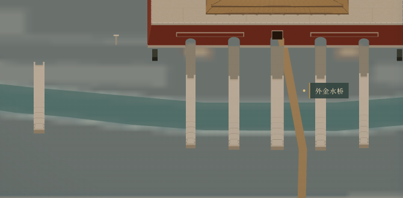

外金水桥近景来自主应用 `1440×1000` 截图的像素裁切，没有修改场景或后期移动桥体。门墙至北侧桥台的长段是独立铺石引道；五座主桥的桥体只用河面南北截面定位，引道终点对着五门洞，没有用整段中点做桥心。两座附桥只保留跨水段。视觉跨水长度至少2.1场景单位，以免总览时栏板不可见，实际水面中心没有随之偏移。河宽、栏板长度和桥拱数仍为概览。

端门正面用于检查宽城台与约六成宽的楼身关系；斜侧面用于检查双重屋檐、九间柱列和五门洞。其模型总高约33米，城台高度和檐口标高为解释值。永定门颜色图用于核对灰砖、灰瓦、绿色剪边和中央券洞。隔离九视角、主应用详情页和窄屏截图均报告pageerror/console error为0。

本轮相关三项单元测试文件11项全部通过，`npm run build`通过，E2E五项全部通过。完整单元套件随后为28个文件通过、13个文件失败；其中六套加载失败都来自其他并行模块的 `completeCourtyardWallNetworks is not defined`，另有太庙围界旧断言失败，均不涉及本轮的端门、天安门、外金水桥或永定门专用测试。这里不把完整套件写成全绿。83条来源ID和URL唯一、目录覆盖一致；精确尺寸和构造限制见[本轮比例校核](../gate-proportions-review-2026-11-14.md)。

## 2026-11-14 · 城门上层柱脚衔接

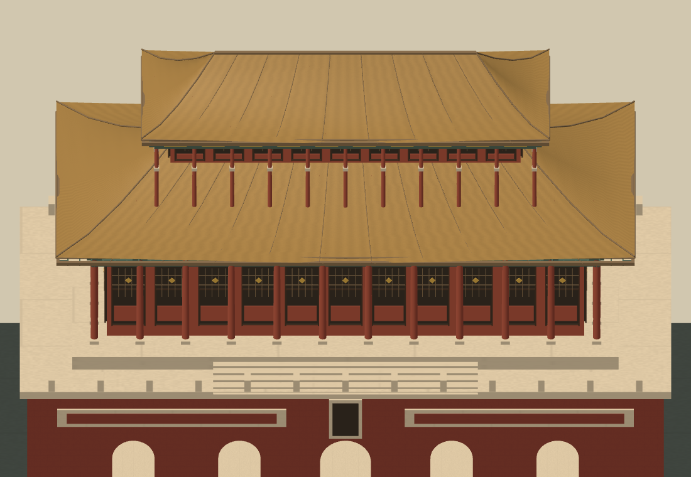

此为首轮失败的天安门模型截图，1100×760，2026-11-14生成。首轮错误地仅延长立柱，墙身门窗仍悬在高处，导致柱子脱离房屋；该图及当时的“已修复”判断均不得作为验收依据。原有3项测试只检查柱脚碰到屋面，漏掉房身连续性；当时构建通过、广场E2E通过和全轴超时也不能证明这一视觉问题已解决。旧图为本项目模型，非历史照片。替代结果见下一条。

## 2026-11-14 · 城门上层房身整体衔接续修

撤回首轮单独延柱，完整墙身、门窗、柱子和梁架共同向下嵌入下层屋面。以下为同日Chromium以项目 `createLandmark`、`createMaterials`、`bake`生成的六个模型视角；1000×760视口，正交相机对准各模型包围盒中心，前视偏移 `[0,10,25]`、侧视偏移 `[24,10,14]`，视野依据包围盒确定。模型截图仅检查房身连续性，不是现实照片、测绘成果或比赛最终验收。

| 对象 | 正面 | 侧面 |
| --- | --- | --- |
| 天安门 | [模型正面](gate-room-tiananmen-front.png) | [模型侧面](gate-room-tiananmen-side.png) |
| 端门 | [模型正面](gate-room-duanmen-front.png) | [模型侧面](gate-room-duanmen-side.png) |
| 永定门 | [模型正面](gate-room-yongdingmen-front.png) | [模型侧面](gate-room-yongdingmen-side.png) |

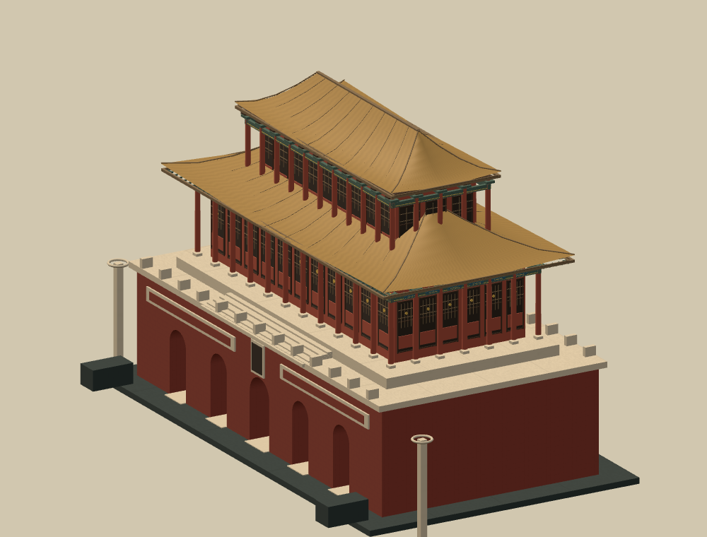

本轮六视角无pageerror/console error。新增房身连续性检查在首轮错误实现上三项均失败，修改后通过；合并运行 `gateSupports`、`palaceMassing`、`templeLayout`、`zhengyang` 四文件26项通过。初次构建被共享工作区宫门测试的类型不匹配阻断，随后 `npm run build` 重试通过，保留Three.js分块超过500kB提示。主应用1440×1000逐一打开三座门详情，均达到ready；390×844没有横向溢出，pageerror/console error为0。本轮未重跑整套E2E。71条来源ID/URL唯一、目录覆盖及本地文档链接检查通过。来源事实不因模型续修改变；细部高度、柱位及构造均为概览解释。实现与取舍见[证据表第9项](../evidence-matrix.md#09--天安门城楼-tiananmen)。

## 2026-11-14 · 城门柱墙与瓦面自然衔接

上条整体续修仍在上层留下外廊式空隙，柱脚与墙窗接入瓦面时显得生硬；该阶段图片保留用于比较。本轮将上层墙窗收拢到柱心平面，并用连续窄收边缓接下层曲面瓦顶，下层开放柱廊保留。四周收边根据真实模型屋面采样，而非加水平大底座或单独拉长柱子。

以下为2026-11-14本地工作树生成的项目模型，使用上条相同的Chromium、灯光、相机偏移和1000×760视口；已逐一查看六个画面。截图不是现实照片，也不证明实际构造和楼层高度。

| 对象 | 正面 | 侧面 |
| --- | --- | --- |
| 天安门 | [模型正面](gate-junction-tiananmen-front.png) | [模型侧面](gate-junction-tiananmen-side.png) |
| 端门 | [模型正面](gate-junction-duanmen-front.png) | [模型侧面](gate-junction-duanmen-side.png) |
| 永定门 | [模型正面](gate-junction-yongdingmen-front.png) | [模型侧面](gate-junction-yongdingmen-side.png) |

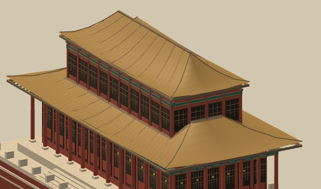

近景为上列天安门侧面图像素区域 `(215,80)—(850,455)` 的635×375裁切，没有改变模型或添加后期构件。

**本轮验证**：柱心贴墙检查在原整体续修模型上三项均失败；修改后四文件（`gateSupports`、`palaceMassing`、`templeLayout`、`zhengyang`）26项通过，覆盖房身/柱脚连续、上层柱墙衔接、收边顶点距真实屋面的范围及下层外廊保留。`npm run build`通过，仍有既存Three.js分块大于500kB提示。隔离六视角和主应用三个详情页均无pageerror/console error；详情页均达到ready，390×844无横向溢出。本轮未重跑完整E2E，不扩大章节/导航验收范围。71条来源ID/URL唯一、目录覆盖及267个本地文档链接检查通过；外部照片没有重新核验，未新增来源或更改地理快照。本图为过程校核，比赛最终交付仍需固定提交版本。

实现与解释边界见[证据表](../evidence-matrix.md#09--天安门城楼-tiananmen)和[建模方法](../methodology.md#2026-11-14--城门楼层柱脚衔接)。

归档日期：2026-11-13起，2026-11-14续增。本图册中的模型校核截图均为本项目自制渲染，不能替代外部来源、历史资料或测绘成果；各条目注明实际生成和检查方式。

## 2026-11-14 · 角楼比例与抱厦补正

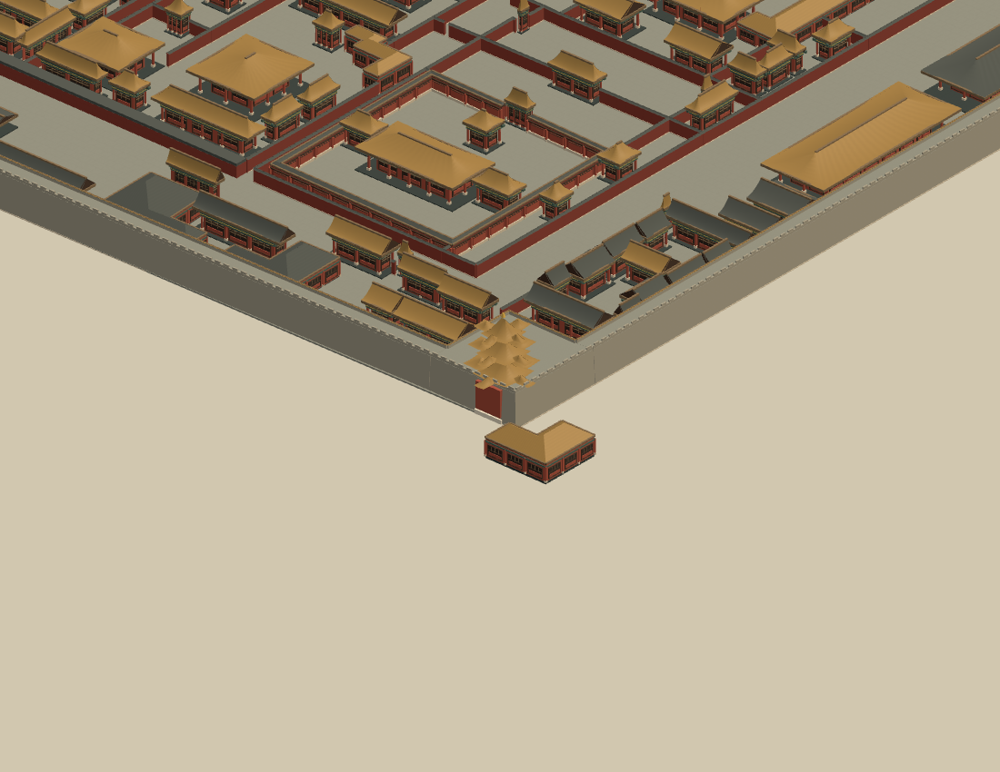

本图为本项目工作树的角楼中间模型截图，非现实建筑照片、测绘记录或最终验收图。隔离渲染以故宫西北角为中心，1100×850视口、19场景单位正交视野；用于检查此前大方顶收敛为较小的中心方亭与方向不对称抱厦组合。依据为馆方文字记录的8.73米中心方亭及1.60/3.98米抱厦进深，屋面交接仍属简化组合。浏览器 `pageerror` 为0；具体局限见[研究记录](../palace-roof-review-2026-11-14.md#角楼比例与抱厦补正)。

截图来自当轮不同阶段，最新代码可能已继续变化；最终比赛版应重新截图并记录提交号、视口和相机。此处保留问题与修正的研究证据，不把中途画面称为最终成品。

## 万宁桥俯视桥位校核

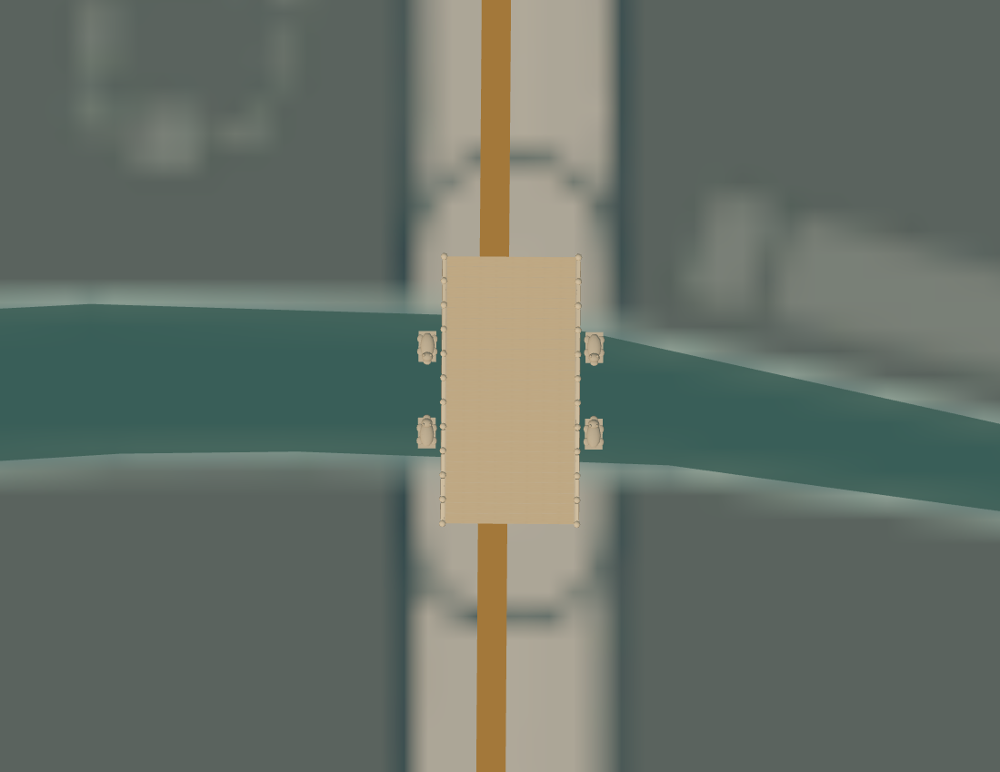

桥身与既有道路同向，覆盖实际水道；标签POI与物理桥心分别处理。此图校核相对位置，不能证明每一石构件实测准确。

## 护城河树列校核

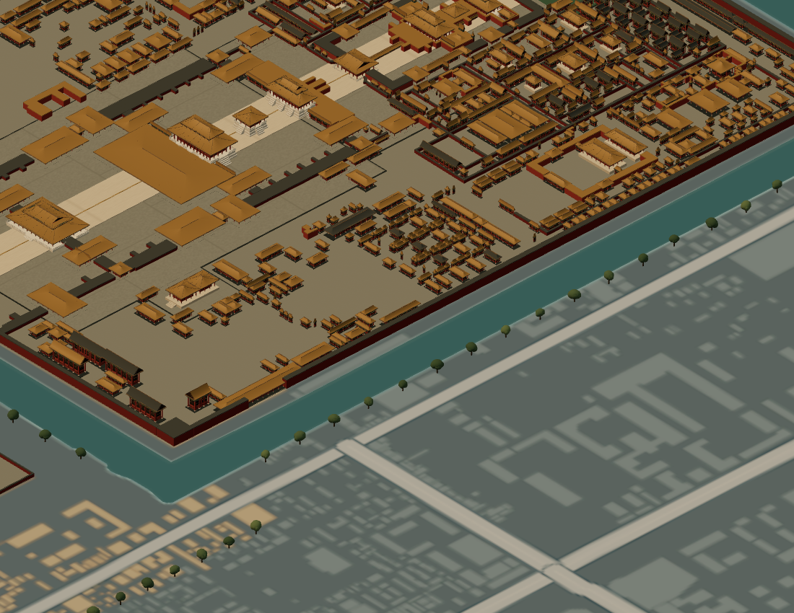

树列移至河岸，保留实际水面。此图记录修正后的局部空间关系，不构成植被历史复原。

## 小型房屋立面校核

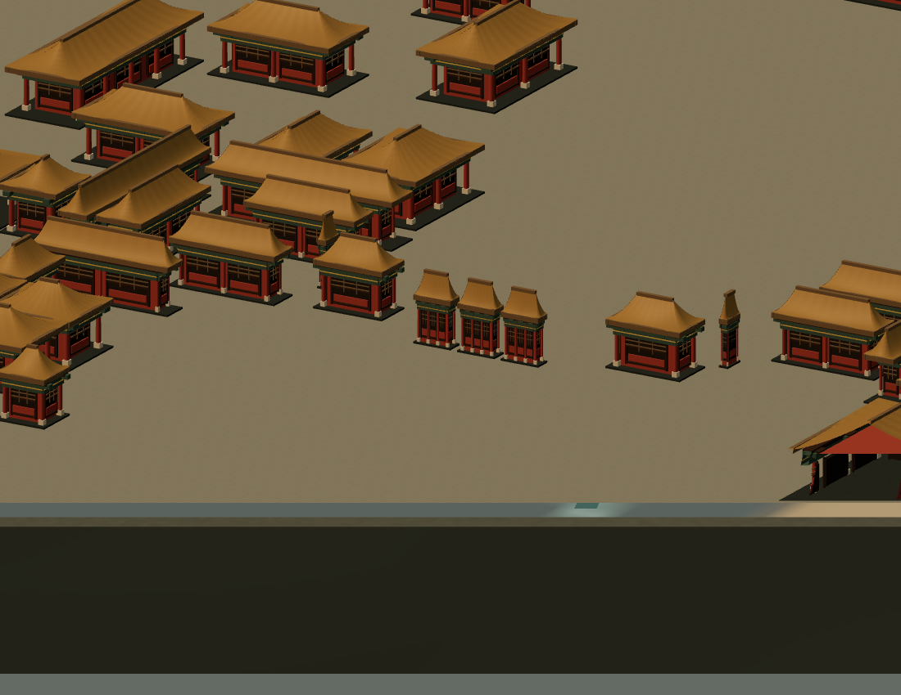

相较空白红块，小屋使用独立柱、窗棂和檐底。只是被抽查的一组，不表示全图小建筑已排查完成。

## 钟楼形制校核

检查灰砖石主体、开敞券洞和两重屋顶；构件、台阶及钟体仍有概化。

## 鼓楼形制校核

检查红台基、木构上层和三重檐的区别；不将图作为原建筑照片。

## 先农坛建筑群校核

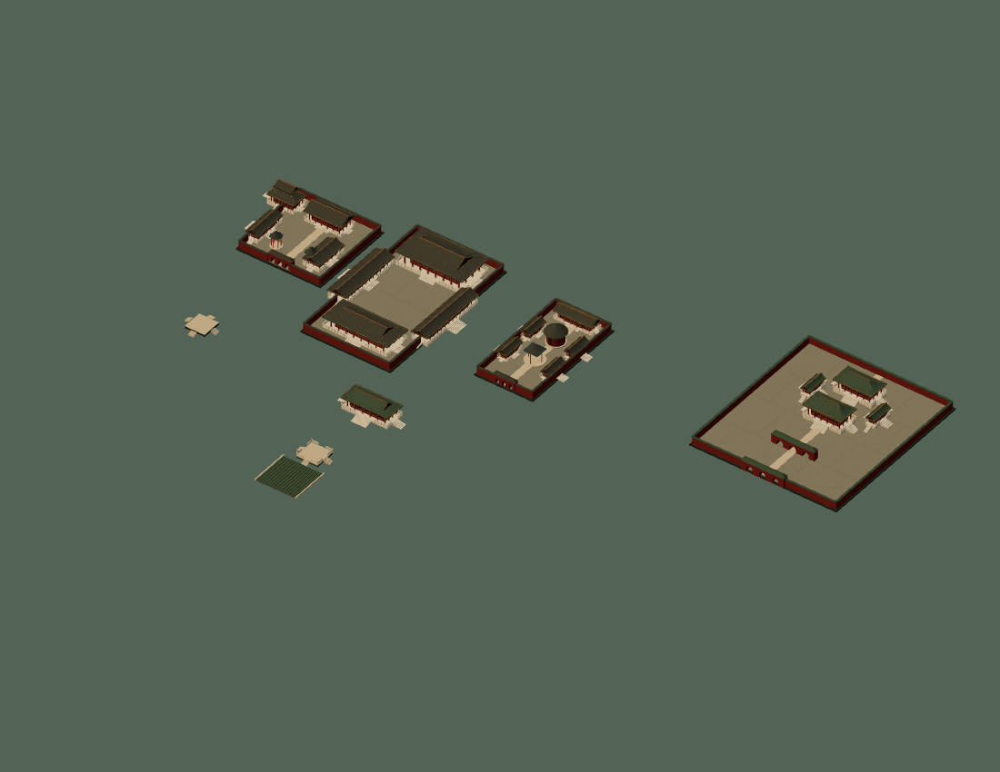

展示本轮扩展的主要殿院和神厨、神仓、庆成宫；新增院落包络是解释性布局，非测绘图。

## 祈谷坛院墙校核

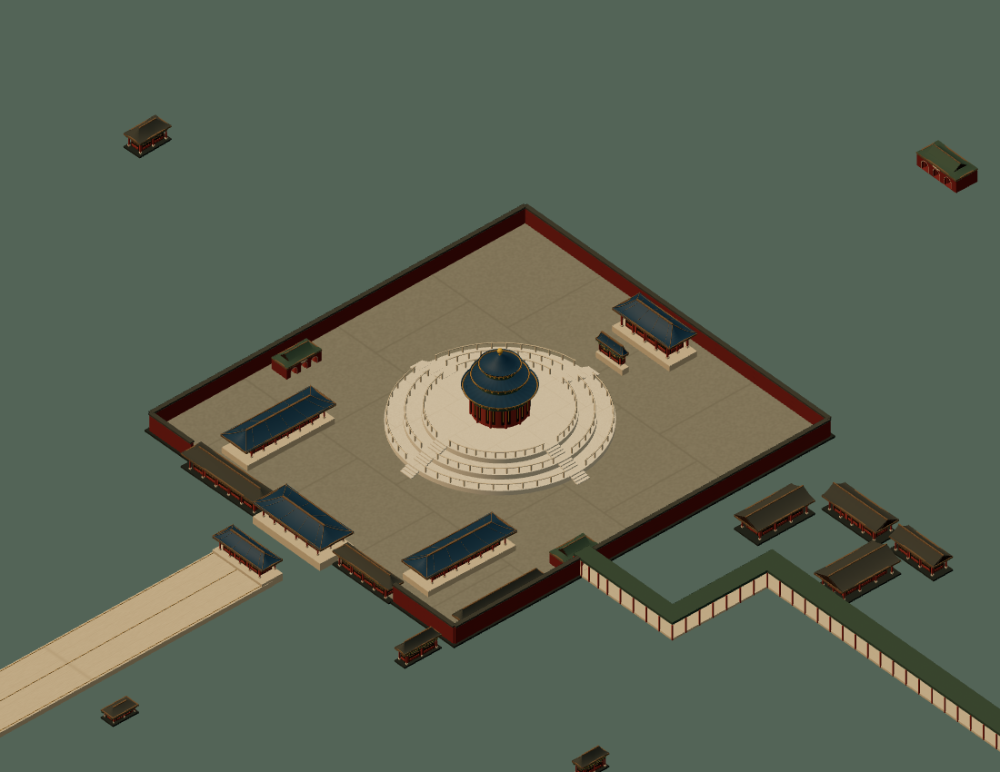

检查实际建筑边界裁切后，院墙不再被长廊外接矩形大段抹除；此图不代表全院细部最终验收。

## 2026-11-14 · 正阳门体量比例校核

以下三张为本轮新生成的项目模型截图，非真实建筑照片。源于基准提交 `c1eb21cace3770f81d35214570624930e7268f52` 上的未提交工作树；不称最终比赛交付。截图生成日期为2026-11-14。

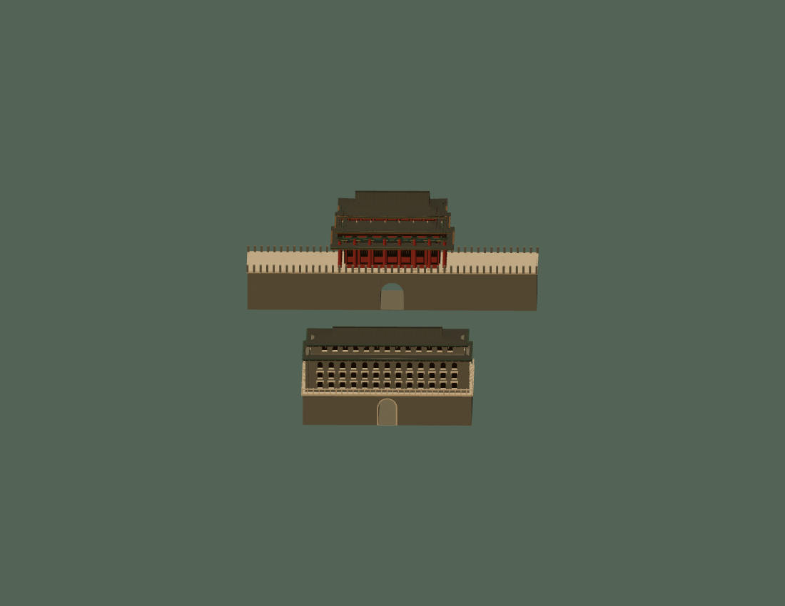

前后局部图使用同一1100×850视口、23场景单位正交视野、相机相对目标偏移 `[0,13,40]`，以建筑组合包络中心为目标；使用实际 `createLandmark`、`createMaterials` 和 `bake`，临时隔离页面检查几何与比例。观察：城台不再过宽过浅，夸张栏柱去除，两层木构与三道檐口更易分辨。此图只支持模型前后比较，不能作为工程尺寸或现状照片。

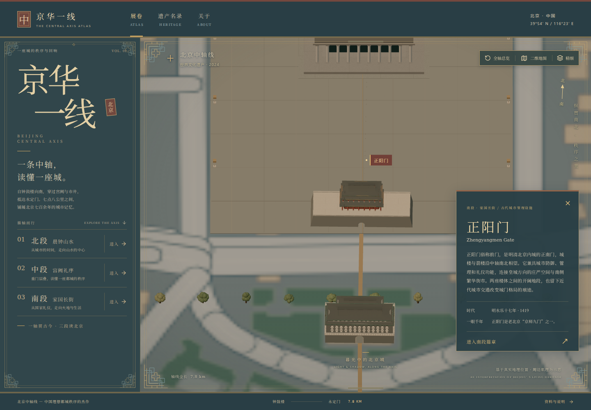

实际应用 `/#/site/zhengyang`，Chromium无头浏览器，1440×1000视口；场景达到ready、详情显示正阳门后截图。该截图可能处于相机过渡中，不用作精确视角对比。之后切换二维地图，确认正阳门屋面SVG路径生成（875字符）；390×844下无横向溢出；页面错误与console error合计0。局部隔离渲染出现多份Three.js导入提示及软件GPU读像素提示，未将该隔离脚本称为无任何警告。

验证命令与实际结果：`npm test -- src/scene/zhengyang.test.ts src/scene/bake.test.ts`，2文件5项通过；`npm run build`通过，保留既有Three.js分块超过500kB的体积提示。本轮没有重新执行全套E2E，也没有以本轮检查代替暂停中的其他地标验收。

对应证据：`ZHENGYANG-FIRE-2020` PDF第2页、`ZHENGYANG-CENTER`；见[证据表第11项](../evidence-matrix.md#11--正阳门-zhengyang)。以下指纹标识本次截图所用关键源码，不代替最终提交号：

- `src/scene/architecture.ts` SHA-256：`acb1e920768a0af2ed628dcf6d78a61d0cc238da6a0683d7271a5ebbab87928c`。
- `src/scene/zhengyangLayout.ts` SHA-256：`6e70572ecde96c90a77cb518710ec2ee10b81824de7f959c95776e2534789a57`。
- `src/components/FlatMap.tsx` SHA-256：`6add6887f51269e40d5a47bbac00d2069b30b3a731da368728470d86687fead6`。
- `src/scene/cityPlan.ts` SHA-256：`d7a6684c7bbbd984616f37d7cc6a1117c6de33f97dfa5a2b71205a2a1a707897`。

## 2026-11-14 · 广场北侧铺地衔接

以下为项目模型的同视角对比，非现实照片，也非最终比赛验收。工作树基准为 `c1eb21cace3770f81d35214570624930e7268f52`，本轮在 `codex/axis-atlas` 修改；工作区还包含其他未提交改动，故以关键文件指纹标识本次修正。

两图均由Chromium无头浏览器调用实际 `createCity` / `createMaterials` / `loadCityData` 渲染，使用1000×600画布、42×25.2场景单位正交视野；旗杆投影为 `[x,z]`，相机 `[x,100,z+32]` 朝向 `[x,0,z-1]`。观察：长安街南侧空带消除，保留道路边缘余量、旗台与东西侧道路；铺地北界在当前模型中向北延伸约23.1m。仅验证场景几何衔接，不能证明实际路宽或保护界线。

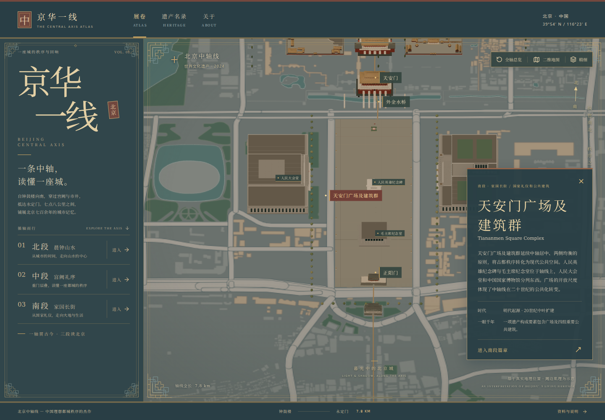

实际应用 `/#/site/square`，1440×1000视口，启用减少动态效果并在场景ready后截图。前后两次页面与局部渲染的pageerror/console error均为0；不据此宣称所有警告为0。

验证：`npm test -- src/scene/squareGround.test.ts src/scene/environmentDetails.test.ts`，2文件5项通过。新增测试修正前失败（道路与铺地间约25m空带），修正后通过；检查北边西端、中轴、东端道路余量与二维共享铺地。`npm run build`最终通过，仍有既有Three.js分块大于500kB提示。首次构建遇到同时编辑中的景山测试签名错误和本轮测试Node类型导入错误；本轮导入已改用Vite原始文本，景山由其工作区改动完成后，第二次构建通过。

资料验证：49个来源ID及URL无重复、目录ID对应、研究文档本地链接有效、清单中全部数据文件字节数及SHA-256一致。此次只核验既有本地OSM快照，无新增来源或外部照片。对应 `GEO-OVERPASS` / `GEO-OSM` 和[证据表第10项](../evidence-matrix.md#10--天安门广场及建筑群-square)。

- `src/scene/squareGround.ts` SHA-256：`737ec7300a31f08235148f76f88ffc0922ed8364903ed5f8b157229535342cf6`。
- `src/scene/squareGround.test.ts` SHA-256：`4d65c64ca49acb97fd36384c89615cd5143431e0faf1da295f4ac7d662ebc6af`。

完整现有浏览器回归：`npx playwright test`，3项通过、2项失败。广场详情及辅助地标、二维地图、iframe返回与焦点检查通过；总览溢出检查和旋转/平移检查均在等待 `.scene-world.is-ready` 时超过15秒，尚未执行到各自后续断言。此处保留失败，不调整测试时限或将整套标为通过。

补充窄屏检查：实际广场详情页390×844，场景ready后无横向溢出，pageerror/console error为0；等待上限60秒，独立执行，不替代上述15秒加载回归失败。截图：[窄屏广场详情](square-north-mobile.png)。

## 2026-11-14 · 正阳门细节回补

本轮新生成的自制模型校核图，不是真实建筑照片。基准提交仍为 `c1eb21cace3770f81d35214570624930e7268f52`，实际使用其上的未提交工作树；其他模块同期仍有改动，未打包提交，以免混入其他工作。

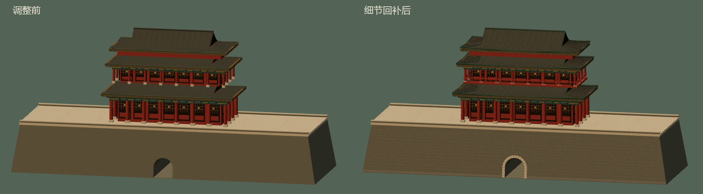

原始全幅：[调整前](zhengyang-detail-before.png)、[回补后](zhengyang-detail-after.png)。局部隔离渲染使用1100×850视口、11场景单位正交视野、相机相对城楼包络中心偏移 `[8,8,40]`；实际调用 `createLandmark`、`createMaterials`、`bake`。对比图仅对这两张同视角截图作同范围裁剪、并排和文字标注，没有改变模型内容。

观察：三道屋面的瓦垄、绿色边脊与山面边线恢复可见；砌筑缝随城台收分贴合；券洞边缘分块，上层回廊补低栏杆和楼板边。保留三重檐、两层木构及校正后的城台比例。图中砖缝、瓦垄抽样、券边分块与栏杆均为模型解释，不作实测构件或完整历史复原证据。

实际检查：

- `npm test -- src/scene/zhengyang.test.ts src/scene/zhengyangDetails.test.ts src/scene/bake.test.ts`：3文件7项通过，包括原有包络与总高、三重屋面细节、合批后门洞多点双向射线畅通、合批数量约束。新增2项在修复前失败、修复后通过。
- `npm run build`：本轮通过；保留Three.js分块超过500kB的体积提醒。后续共享工作树又有其他模块新增，因此此结果只说明当次构建，不代表同期所有工作完成。
- 局部截图已目视对照。隔离渲染脚本有多份Three.js导入提示及软件GPU读像素提示，未称其为无警告环境。
- `npm test` 全套首轮87项通过、2项在5秒限制下超时；限2个worker复跑时，工作树新增的 `centralGreenery.test.ts` 引用了当时尚不存在的模块，另有8项故宫体量测试失败，89项通过。未修改这些测试或削弱断言，未声称整仓单测全绿。
- `npx playwright test`：1项章节返回/焦点检查通过、4项失败，其中3项未在15秒内达到scene ready，1项拖动操作超时。未扩大默认超时以宣称通过；保留该轮未通过状态。
- 来源登记共49个唯一ID/URL，正阳门两来源在目录与证据表中均可对应；`git diff --check`通过。未更换地理数据，数据快照清单无需重算。

下列文件指纹标识细节修复，不能替代最终交付提交号：

- `src/scene/architecture.ts` SHA-256：`7462d372d8c8633b8465f40beb07d72cc73eebe9f53ceb67b384fcb8ca5574b9`。
- `src/scene/zhengyangDetails.ts` SHA-256：`d1f4083552a6d13a58020d4207761a256a3da7e3f828a2f6bc271b97c6e4ea01`。
- `src/scene/zhengyangDetails.test.ts` SHA-256：`fd0b0f9487bc5116a8f6392a84cce4ed6ffa9d22f9437c9a09fd8398bc1653d6`。
- `src/scene/zhengyangLayout.ts` SHA-256：`6e70572ecde96c90a77cb518710ec2ee10b81824de7f959c95776e2534789a57`。

## 2026-11-14 · 景山山体占路修正

以下为本项目模型运行截图，不是真实地貌或现状测绘照片。基准提交仍为 `c1eb21cace3770f81d35214570624930e7268f52` 加未提交工作树；用于本轮局部问题复核，不作为最终比赛验收。

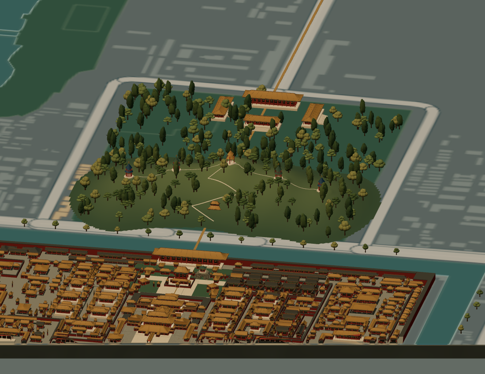

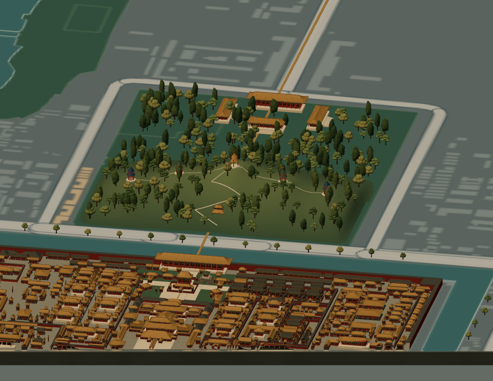

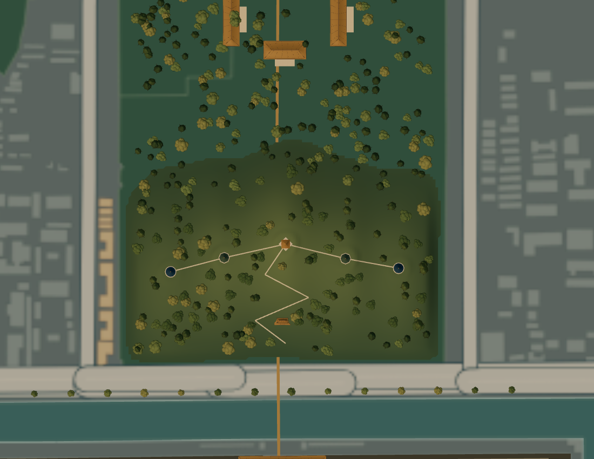

局部全城场景检查使用 `createCity`、真实本地地图数据和实际材质；1100×850视口。前后侧视的正交视野均为57场景单位，相机相对目标偏移 `[10,22,50]`；俯视为60场景单位、偏移 `[0,100,0.001]`，目标GCJ-02 `[116.3969,39.9251]`。观察：西侧、南侧道路及其边缘重新露出，山体与坡脚步道收在园内；树冠避让园界。图中的形状仍为程序山势，不能用它证明山脚线、树种数量或坡度测量准确。

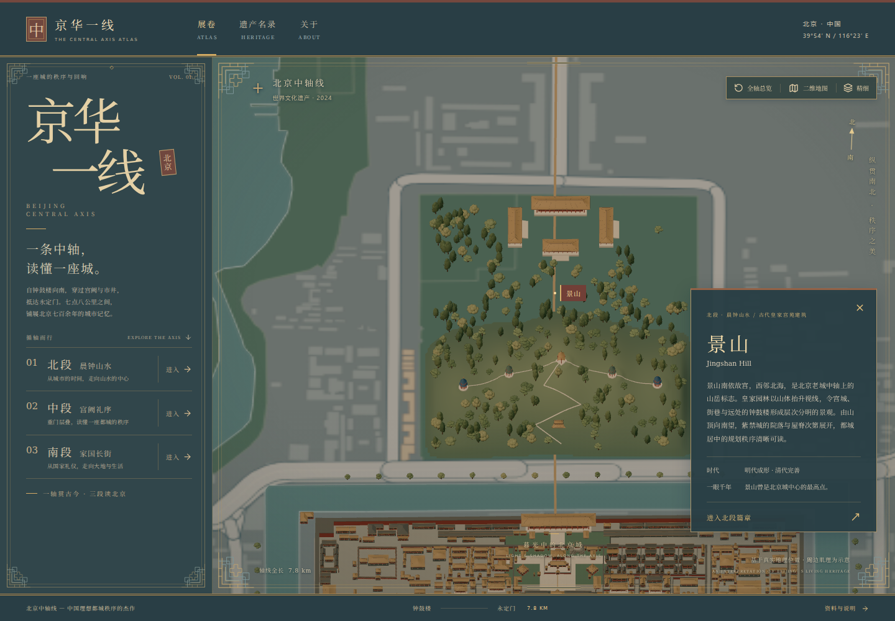

实际应用检查：Chromium无头浏览器，1440×1000，路由 `/#/site/jingshan`，本次等待ready约5323ms，页面错误及console error合计0；随后切换二维地图，景山屋面SVG路径正常生成（15703字符）；390×844无横向溢出。临时脚本起初按容器可见性等待超时，但容器已具有is-ready类且截图已正常渲染；最终按项目既有ready状态约定检查，未扩大15s期限。

实际验证：`npm test -- --maxWorkers=1 src/scene/jingshanTerrain.test.ts src/scene/environmentDetails.test.ts src/scene/forest.test.ts`，3文件8项通过；`npm run build`通过，保留Three.js分块超过500kB的打包提示。原全图树冠避水检查超时后，为水面多边形增加外包框预筛选，仍检查全部树、40个圆周采样点和原有点在多边形内判定，未改变阈值或超时限制。没有重新执行整套E2E。

本轮依据沿用 `GEO-OVERPASS` / `GEO-OSM`，见[证据表第3项](../evidence-matrix.md#03--景山-jingshan)。截图所用关键代码指纹：

- `src/scene/jingshanTerrain.ts` SHA-256：`7221b953febeffcc4e87f87e48e6453a17b68b259227ea06a579dae574962765`。
- `src/scene/forest.ts` SHA-256：`f25e4df3f075a3924625da63d51ef4fa082150e4c12f4a7ad1c462f13422cabf`。
- `src/scene/architecture.ts` SHA-256：`7462d372d8c8633b8465f40beb07d72cc73eebe9f53ceb67b384fcb8ca5574b9`。

## 2026-11-14 · 景山树木与建筑避让

用户截图中的配房被随机树木穿入。下图为项目模型的同视角修正对比，不是现实照片或最终比赛验收。沿用本地 `GEO-OVERPASS` / `GEO-OSM` 建筑数据；程序配房、前殿和树木位置均不新增历史事实声明。

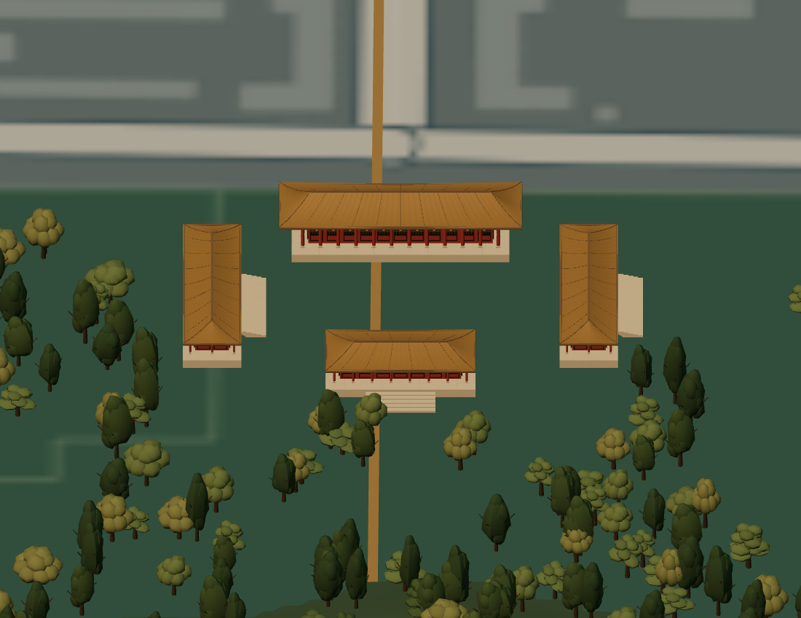

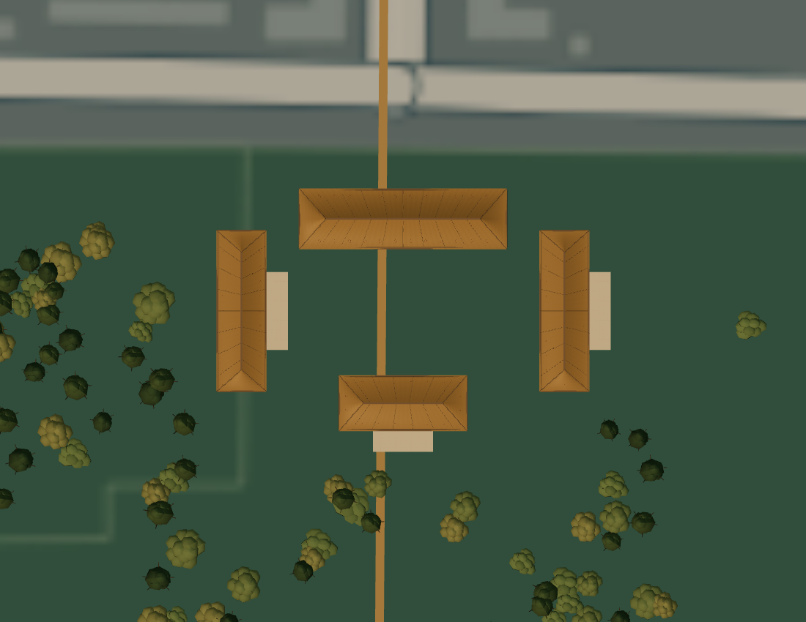

局部图由Chromium调用实际 `createCity` 渲染，1100×850；以寿皇殿模型中心向南4单位为观察点，近景正交纵向视野23单位、相机相对观察点 `[0,28,34]`，俯视27单位、相机偏移 `[0,100,0.001]`。共享配房布局保持原建筑位置、旋转与尺寸，增加包含屋檐、前阶和亭台的植树禁入范围。树冠使用原有保守圆盘，不能据此判断实地逐树分布。

验证记录：

- 新增测试直接读取渲染建筑网格包络，修正前有建筑快照的用例发现27棵树的安全圆盘侵入建筑；无快照用例同样失败。修正后有/无快照两项均通过。
- `npm test -- src/scene/jingshanTrees.test.ts src/scene/jingshanTerrain.test.ts src/scene/forest.test.ts`：3文件6项通过。
- `npm run build`：通过，保留Three.js分块大于500kB的体积提示。
- 景山实际页面ready耗时8.5秒，pageerror/console error均为0；二维屋面生成；390×844无横向溢出。局部隔离渲染不作为无警告声明。
- `npx playwright test -g 'chapter|accessible'`：实际匹配1项，iframe返回及焦点测试通过；未声称本轮重跑完整E2E。
- 完整 `npm test`：97通过、5失败，其中中央绿地及太庙两项为5秒超时；这两文件与凹形建筑测试以 `--maxWorkers=1` 复跑后15通过、3失败。剩余3项是 `polygonBuildings.test.ts` 找不到 `mapped-concave-roof`，属于本轮景山修改之外的工作区问题，未修改其实现或断言。
- 来源ID/URL无重复、来源目录对应、全部数据清单大小和SHA-256一致。核验时来源57条（包括其他并行工作增补），本次景山修正无新增来源；未重新下载地图数据。

工作区包含并行未提交修改，本次没有创建混合提交。截图基准HEAD：`c1eb21cace3770f81d35214570624930e7268f52`，不能代表整个截图工作区已提交；以以下源码指纹补充标识：

- `src/scene/jingshanLayout.ts` SHA-256：`d648cbac628968f283a49f8d52f686f68794811508218bd71545ea0060ce67a6`。
- `src/scene/jingshanTrees.test.ts` SHA-256：`6f2447dcc6464fc06ced9e3004357d067decf43cc7d4642d5e2a7a331e957145`。
- `src/scene/architecture.ts` SHA-256：`7462d372d8c8633b8465f40beb07d72cc73eebe9f53ceb67b384fcb8ca5574b9`。
- `src/scene/forest.ts` SHA-256：`f25e4df3f075a3924625da63d51ef4fa082150e4c12f4a7ad1c462f13422cabf`。

本轮新增景山图册链接均存在。全研究目录链接扫描另发现并行增补所引用的 `greenery-review-2026-11-14.md` 尚未落盘；未将全目录链接检查记为通过。代码块内Overpass查询坐标不是Markdown文件链接，排除在断链判断之外。

最终应用检查：Chromium无头浏览器，1440×1000视口，`/#/site/zhengyang`，约10.5秒达到scene ready，随后等待相机过渡并截图。二维正阳门屋面SVG路径长度875；390×844下无横向溢出；页面异常与console error均为0。由于前一次15秒等待曾超时，此次诊断脚本允许最多60秒观测，没有修改E2E的默认断言，也没有把这次手动观测称为全套E2E通过。独立入口另以 `/chapters/{north,central,south}/index.html` 逐一打开，均HTTP 200、显示对应“分区接入示例”标题、具有1个返回按钮；这些是集成示例，不是队友最终章节。

## 2026-11-14 · 广场与端门周边绿化核查

以下均为本项目模型截图，非现场照片或最终比赛验收。基准提交 `c1eb21cace3770f81d35214570624930e7268f52` 上的未提交工作树；同一目录还有其他会话的并行改动，因此本轮未将其一并提交。

| 截图 | 观察与限制 |
| --- | --- |
| [广场两侧低矮种植带](greenery-square.png) | 原贯通乔木线已移除，两片种植带位于广场北半部内侧；轮廓及装饰为示意，不是当日花卉方案 |
| [社稷坛外围柏林](greenery-shejitan.png) | 从地标固定偏移树线改为内坛围墙外围的局部柏林，保留入口；尚非全园完整植被图 |
| [端门庭院与相邻绿化](greenery-duanmen.png) | 端门阔叶树独立于两侧坛庙柏林，中央通道留空；单株位置/树种仍为解释 |
| [端门窄屏](greenery-mobile.png) | 390×844实际页面，未出现横向溢出；不等于手机GPU实机性能测试 |

桌面截图：Chromium无头浏览器、SwiftShader、1200×850、deviceScaleFactor=1，使用系统“减弱动态效果”偏好，直接打开实际页面对应地标路由。桌面三张与窄屏均完成截图，pageerror及console error为空；Tab后焦点落在链接。首轮1440×1000且启用动画的第二张截图超过30秒，未当作通过；后续上述独立检查成功，不提高仓库默认测试阈值。

实际验证：

- `npm test -- src/scene/centralGreenery.test.ts src/scene/forest.test.ts src/scene/squareGround.test.ts src/scene/environmentDetails.test.ts src/scene/bake.test.ts --maxWorkers=2`：5文件12项通过。涵盖水面/建筑树冠避让、坛庙与中央通道分离、广场铺地内低矮绿化及既有场景回归。
- `npm run build`通过；仍有Three.js分块超过500kB的体积提醒。未宣称整仓所有单测/端到端套件本轮全绿。
- 独立Playwright交互检查：二维图存在2片种植带；390×844无横向溢出；北段iframe返回并将焦点还给品牌链接；无pageerror/console error。
- 来源登记57个唯一ID/URL，新增8项均能对应来源目录与专题记录；本轮相关研究文档相对链接无缺失，`git diff --check`通过。未变更地理快照。

详细依据、来源访问限制和未完成项见[绿化核查](../greenery-review-2026-11-14.md)。以下SHA-256标识本轮实现，不能替代最终交付提交号：

- `src/scene/centralGreenery.ts`：`015ee75e20b68f12eb95b0acb87f5e6dec00ab94fbe40ff8ac710d447494e4df`。
- `src/scene/forest.ts`：`fa4e9117dc04040a454a5658ccae5f69e853d8a064120f62ec1ae71171dd230a`。
- `src/scene/civicLayout.ts`：`877f8e4e074fb2f25dc9168053059562784653d104dcc0848e9b3c4e48eaf246`。
- `src/styles.css`：`5d50d818a501e0432f6b7d2c07cc90123c61e39f9b568f1bc14a7ed16647b366`。
- `src/scene/centralGreenery.test.ts`：`6b49c605859127f42db19dbdb6f79b30f5c0a2f6ecbfdb304b29fe0c76aa2443`。

## 2026-11-14 · 故宫屋面与台基纠错

本轮新生成的自制模型截图，非实景照片。基准提交 `c1eb21cace3770f81d35214570624930e7268f52`，工作分支 `codex/axis-atlas`，当前共享工作树含其他任务未提交改动；没有将其一并提交，也不称最终比赛验收。

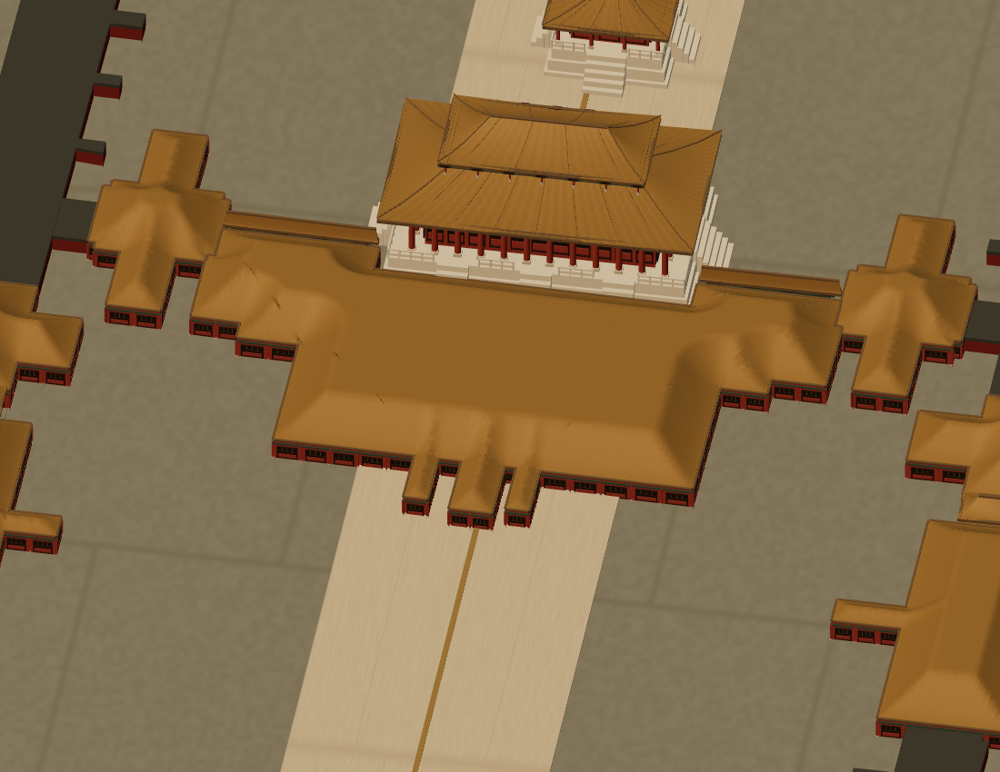

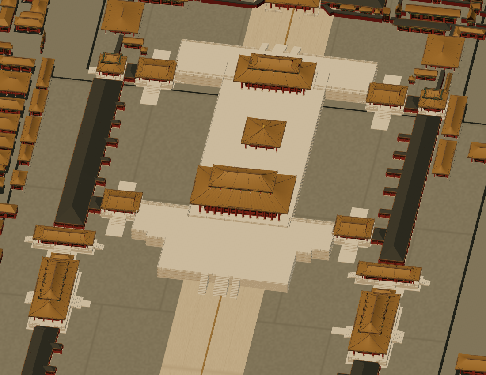

局部渲染调用实际 `createLandmark`、`createMaterials` 和 `bake`；1100×850视口。修正前图以way638449433的模型包络为中心、正交跨度16；修正后近景以太和殿包络为中心、跨度16，共用台基概览跨度25，两者相机相对目标均为 `[6,32,36]`。目标中心不同，不能将前后图当成逐像素回归。灰顶详情以院墙6为中心、跨度9、偏移 `[-26,12,8]`。示意连接台面宽度、栏杆数量、侧门核心宽深和墙面分格不构成测绘认证。

实际应用检查：Chromium、1440×1000、`/#/site/forbidden-city`；等待场景ready和详情标题后截图，相机可能仍在过渡。二维故宫屋面路径生成，390×844下横向溢出为false，页面错误和console error合计0。隔离渲染有Three.js重复导入提示和软件GPU ReadPixels提示，未声称零警告。

实际验证：

- 故宫及凹形屋面5文件22项通过；最后一次执行 `npm test -- --maxWorkers=2 src/scene/palaceMassing.test.ts src/scene/palaceArchitecture.test.ts src/scene/palaceWallDetails.test.ts src/scene/polygonBuildings.test.ts src/scene/polygonRoof.test.ts`。
- 全量默认并发首轮96/99通过，3项为5秒超时；限制worker为2后 `npm test -- --maxWorkers=2` 的25文件99项全部通过，没有放宽测试超时或删减断言。
- `npm run build`通过，保留Three.js包超过500kB提示。
- `npx playwright test`首轮2/5通过；后续重建并串行复核4/5通过：总览/窄屏、广场详情、二维地图、iframe返回和焦点通过。Shift旋转后普通拖动仍在60秒处超时，未完成该项，不宣称全套E2E通过。
- 来源ID与URL去重、目录对应、研究文档相对链接、7份既有数据快照的字节数/SHA-256及 `git diff --check` 通过。

来源、对象误判和替换理由详见[本轮研究记录](../palace-roof-review-2026-11-14.md)。以下源码指纹记录局部截图生成后的版本；共享总装文件可能由并行工作继续改变，最终提交号仍待交付时补齐。

- `src/scene/palaceMassing.ts` SHA-256：`6b47c33e7d95652b32448f7056bcb85728ced759c40849b4b610a36ef19bf177`。
- `src/scene/palacePlatforms.ts` SHA-256：`31d60bbc439c79758fec39614b02acf2c6568fac2a9f333e33618d2c8300a9a6`。
- `src/scene/polygonBuildings.ts` SHA-256：`2f5779cfe140525f0113a3dca3fe30b192b88ae4d6f867f0438ea50d3039abdb`。
- `src/scene/polygonRoof.ts` SHA-256：`d1f1924b8c911cbb4a8cc8126680aad876e49fa95ac15bcfcb407906009e6d8b`。

## 2026-11-14 · 景山五亭细化

以下均为项目模型校核图，非真实建筑照片。生成于2026-11-14，基准提交 `c1eb21cace3770f81d35214570624930e7268f52` 的未提交工作树；工作区同时存在其他改动，以关键文件哈希补充定位。不是最终参赛发布验收。

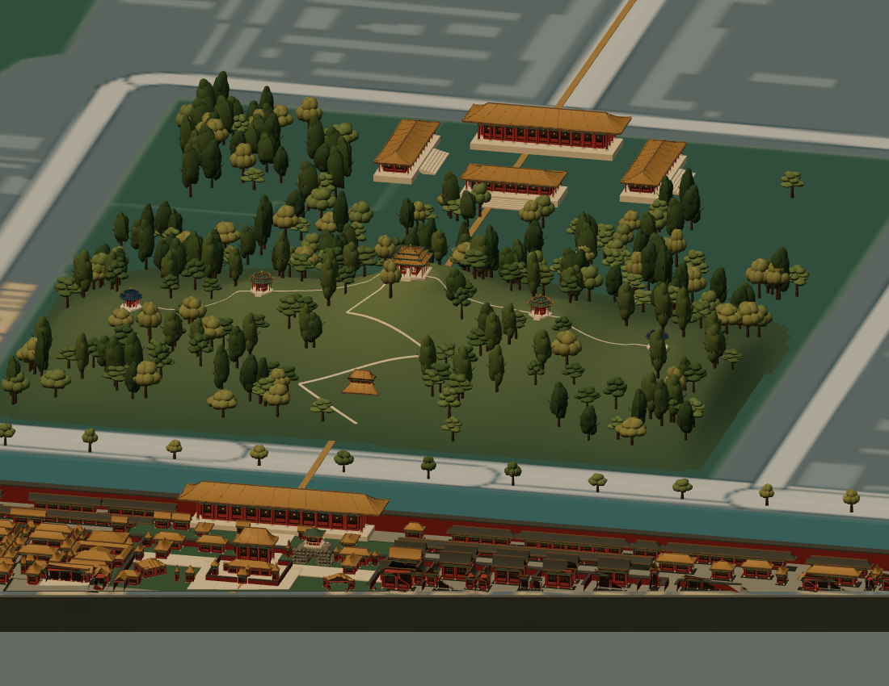

同一1100×850视口、38单位正交视野、目标GCJ-02 `[116.3969,39.9251]`、相机相对偏移 `[8,13,34]`；运行实际 `createCity` 的完整场景，包含现有植被和受园界/道路约束的山体。观察：旧亭的细柱和尖锥顶被有区别的三檐方亭、双檐八角亭与圆亭替换，侧亭的夸大高度减少，原亭位保留。

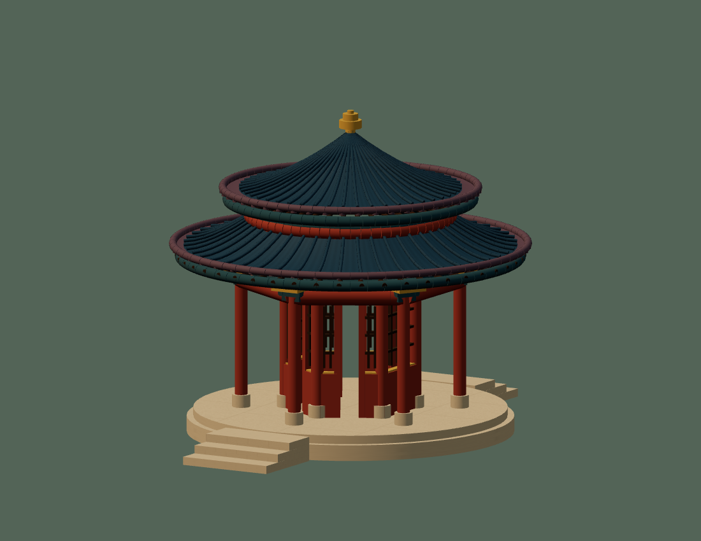

近景均1100×850，分别以万春亭、辑芳亭、周赏亭生成模型的包络中心为目标，正交视野2.65/2.05/1.95单位，相对偏移 `[3,1.4,5]` / `[3,1.1,5]` / `[3,1.1,5]`。使用真实 `createLandmark`、本地 `createMaterials` 与 `bake`；检查曲面重檐、剪边、瓦条、柱廊、简化斗拱、槛窗及石台阶。孤立渲染脚本出现多份Three.js导入及软件GPU ReadPixels性能提示；不将该脚本描述为完全无警告。

实际 `/#/site/jingshan` 1440×1000页面，ready约3330ms后检查；切换二维地图成功（屋面路径15703字符）；390×844无横向溢出，pageerror/console error为0。相机过渡截图只用于页面运行校核，不据此判断建筑测量精度。

回归：`npm test -- --maxWorkers=1 src/scene/jingshanPavilions.test.ts src/scene/jingshanTrees.test.ts src/scene/jingshanTerrain.test.ts src/scene/bake.test.ts`，4文件10项通过。覆盖亭型/高度、32柱、开敞门道、曲面及裙檐中孔、宝顶承接、树冠避让、山体道路约束与几何合批；没有运行全套E2E。最终几何修改后再次执行 `npm run build`，TypeScript与Vite构建通过（29.52s）；保留Three.js分块超过500kB的体积提示。`git diff --check`通过；研究目录本地链接及4个新增来源ID引用一致，来源总数65、ID与URL无重复。

来源为 `JING-WANCHUN-PARK`、`JING-JIFANG-PARK`、`JING-ZHOUSHANG-PARK` 与 `JING-DPM-P38`。图中檐出、层高分配、斗拱叠块和窗格是模型解释，不是节点测绘或完整彩画复原。PDF完整书目与现状立面仍待补。源码指纹：
- `src/scene/jingshanPavilions.ts` SHA-256：`2603e3cf0a7f5543dd776a7091642e8c915c41bb6f88968e4830c18d0ff26b67`。
- `src/scene/architecture.ts` SHA-256：`9d7d7b3b556fb32160a2a1125af65e390a585687b1dee73dbc328bd9a7bb58b0`。
- `src/scene/jingshanLayout.ts` SHA-256：`62b2cd412b94cd15c3879c18581bc417583fcfcf2b2caa7b1ea772f5a7b49013`。
- `src/scene/jingshanTerrain.ts` SHA-256：`8b2b73c2b0a47193b2fe91347b6b754f36c0046695c2d1be1a652023078fc812`。
- `src/scene/materials.ts` SHA-256：`f7d31be37187613f37360915451b3ba8029ebbd84284bb02ec08abfa62faa814`。

## 2026-11-14 · 故宫西北部围墙补全

2026-11-14生成的项目模型校核图，非真实建筑照片。基准提交 `c1eb21cace3770f81d35214570624930e7268f52` 上的未提交工作树；同时存在其他未提交工作，以文件哈希标识本次关键源码。不是最终比赛验收版本。

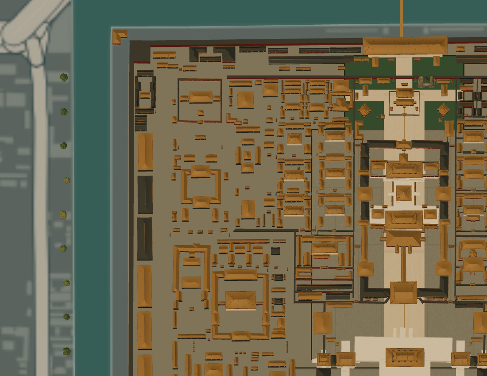

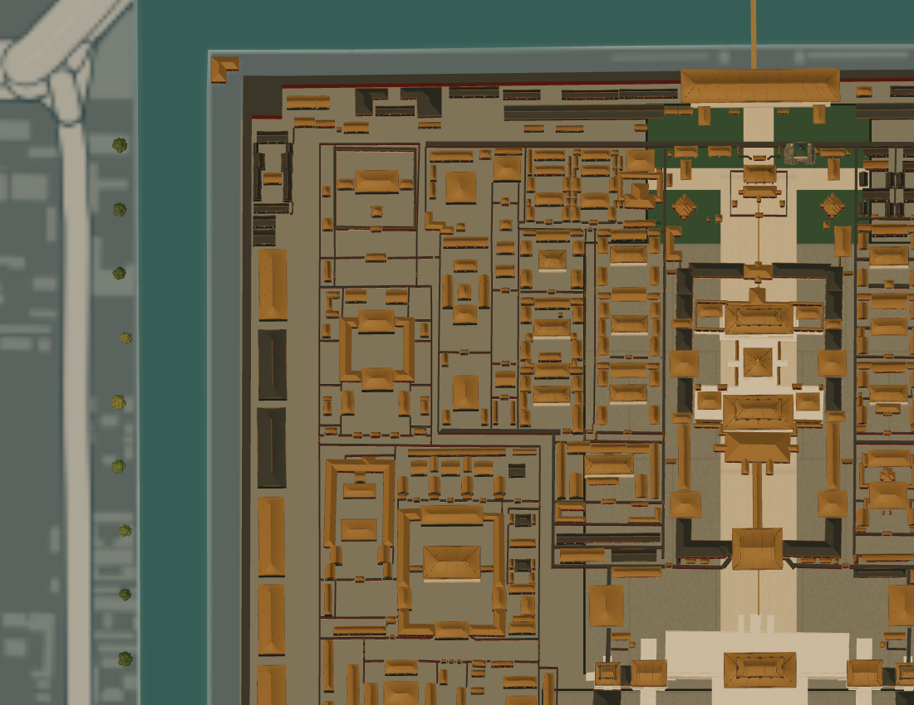

同一1100×850视口、51单位正交视野；WGS84目标 `[116.3881,39.9191]` 经既有GCJ-02转换和场景投影，相机相对偏移 `[0,70,18]`。实际 `createCity` 加载本地数据后渲染。观察：寿安宫、英华殿周边与建福宫附近原先连成空地的院落恢复分隔墙；墙线沿源折线连接，未在每个庭院外接框画封闭矩形。场景中的其他未完成细部不在此轮验收范围。

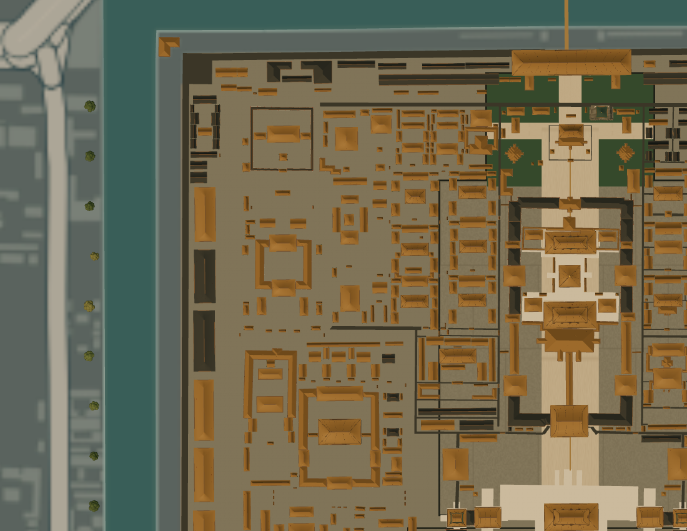

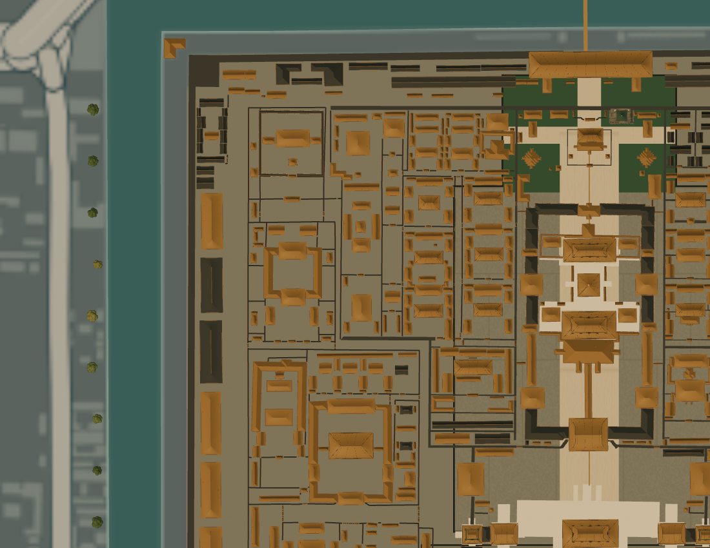

同一目标和视口，正交相机相对偏移 `[0,100,.001]`；检查新增线与源地图、现有建筑及旧墙的相对关系。四个视图为完整场景的局部镜头，不能证明现实中没有其余缺墙。

实际 `/#/site/forbidden-city` 页面1440×1000，ready约3395ms，console error与pageerror均为0。切换二维地图后屋面路径265420字符、院墙路径113848字符；390×844无横向溢出。`palaceWallRuns` 在该快照与建筑裁切条件下输出464段、涉及179个源way；这不是179座院落，也不等于原始189条围墙全部完整呈现。

验证命令：`npm test -- --maxWorkers=1 src/scene/palaceWalls.test.ts src/scene/wallRuns.test.ts src/scene/palaceWallDetails.test.ts src/scene/palaceMassing.test.ts src/scene/bake.test.ts`，5文件15项通过。检查西北关键墙线、源折线溯源、宫界、真实凹形建筑裁切、去重、入口、既有灰顶墙细节及宫殿台基/合批回归。未运行全套E2E。`npm run build`通过（29.17s），保留既有Three.js分块超过500kB提示；`git diff --check`通过。10项数据清单的大小/哈希与189条原始围墙坐标逐一核对通过，65个来源ID及URL无重复，研究文档本地链接存在。

地理证据沿用 `GEO-OVERPASS` / `GEO-OSM`；专门查询的原始响应、历史请求时间、服务器基准时间、WGS84坐标、ODbL署名和哈希均已归档。默认墙身尺寸、石脚、灰瓦帽、入口宽度和防穿插余量是导览模型参数，非现状逐墙测绘。源码指纹：

- `src/scene/palaceWalls.ts` SHA-256：`721108b44696eecf9a816cb47a8f1b898fff844e8ecc14517efd090e9b275c80`。
- `src/data/palace-walls.json` SHA-256：`0adb31970e0dad46c528de5985702c04bab0e4e022e47d0d48d3d1a8bd45fcee`。
- `src/scene/architecture.ts` SHA-256：`d5e14f5910f2e7d3399f00dbc43be3cfa11903647cc077f107485f9134f3c406`。
- `src/components/FlatMap.tsx` SHA-256：`de8048b423025373d72477a13fb7c61e68ababb59a9c91d3ba9258af535a2a63`。

## 2026-11-14 · 故宫台沿栏杆补正

以下为本项目模型的同视角前后截图，非现实照片或最终比赛验收。基于工作树基准 `b6ee3df217a6b7975b9204538dd2cbc4ba4212ac` 加本轮栏杆修正；模型源码 `src/scene/palacePlatforms.ts` SHA-256 为 `f2a25b367f711163b420380b996f55ef0f825825dd381dc55ca69375348dec4a`。

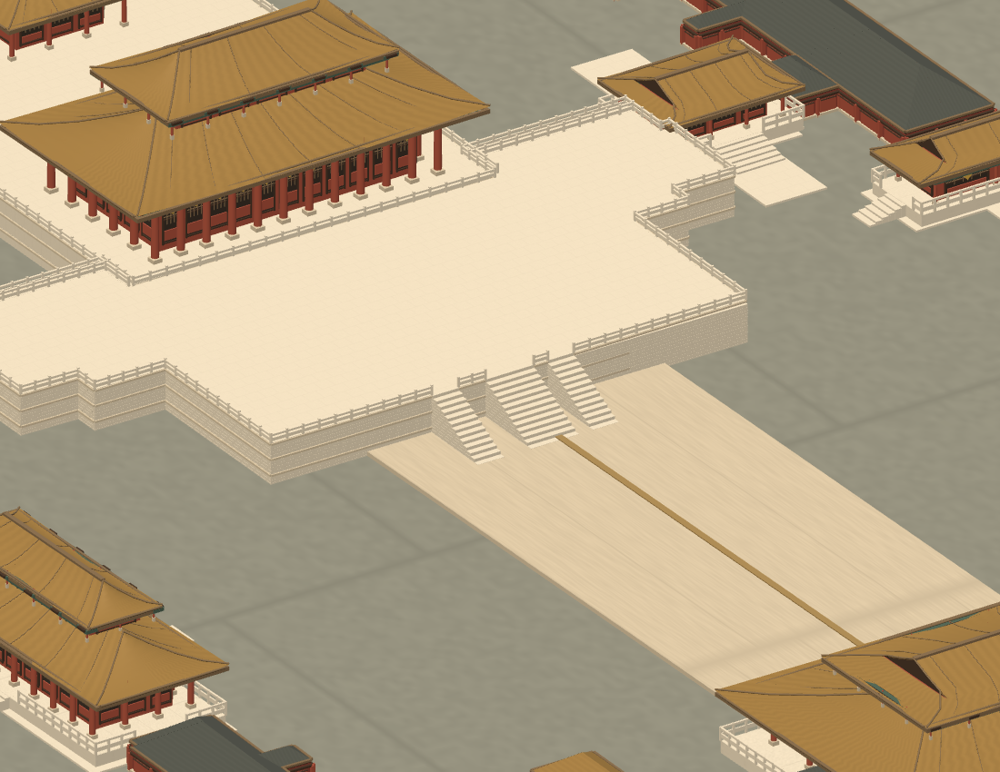

两图由 Chromium 无头浏览器调用实际 `createLandmark` / `createMaterials` / `bake` 渲染；视口1100×850，正交竖向视野12场景单位，相机相对目标偏移 `[-16,15,24]`。目标X为南平台way `638449433`的左右包络中心，Y为0.5，Z为其最南点向北1.7场景单位。观察：右侧长台沿和垂直转角补齐；三处台阶入口没有被横栏封住。不能用该截图证明栏杆节点和间距为实测。

验证：新增回归初跑4项均失败；修正后南北裁切、真实南北平台及共享台面开口5项通过，与既有台基分类测试合计2文件13项通过。`npm run build`通过，仍有既有Three.js分块超过500kB的提示；首次构建的测试材质类型错误已修复。全量 `npm test -- --maxWorkers=2` 为28文件111项，其中109项通过、绿化与太庙两个既有测试各超时一次；浏览器检查结束后用 `--maxWorkers=1` 单独重跑两个文件，12项全部通过。未改超时阈值，未宣称全量单轮无失败。本轮未重跑整套E2E。

实际应用 `/#/site/forbidden-city` 于1440×1000视口达到场景ready并显示“故宫”标题；页面错误及console error为0，切换390×844后无横向溢出。隔离模型截图也未出现pageerror，但没有宣称所有console warning为0。初次修改后开发服务器因WSL文件监测未刷新而仍显示旧模块；重启后重新截图确认已载入新逻辑。

本次再次直接下载核对 `PAL-TAIHE` 栏杆文字；65条来源ID/URL去重、目录ID对应及研究文档本地文件链接检查通过，未改地图快照和清单。研究依据、算法解释与缺口见[补正记录](../palace-roof-review-2026-11-14.md#台沿栏杆缺口补正)。

## 2026-11-14 · 天坛与景山铺地和道路连接

以下均为本项目模型截图，桌面1440×1000、窄屏390×844。桌面修正后截图临时隐藏详情面板以便观察；院落近景使用实际场景拖动与缩放。道路折点、路宽和院内硬铺比例为导览示意，未以这些截图证明现状准确性。

- [天坛修正前](tiantan-paths-before.png)：只有丹陛桥，斋宫内仍为草地。
- [天坛路网修正后](tiantan-paths-overview.png)：横向和侧向通路、附属院落接入。
- [斋宫院落近景](tiantan-courtyard-after.png)：护河内铺地、三向入口连接及树冠留白。
- [景山修正后](jingshan-paving-after.png)：寿皇殿与绮望楼铺地、前后山通路及东西登山连接。
- [天坛窄屏](tiantan-paths-mobile.png)：布局与浏览器检查，非全园视觉验收。

证据、实际验证结果与限制见[本轮记录](../tiantan-ground-review-2026-11-14.md)。

## 2026-11-14 · 中和殿朝向与中心补正

以下是本项目模型的同视角俯视对比，非现实照片、实测图或最终比赛验收。基于 `aa7ba4f` 工作树与本轮修正；本轮还保留前项台沿栏杆修正。

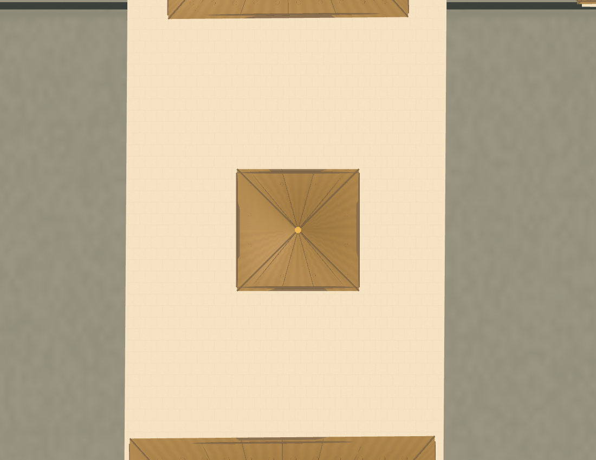

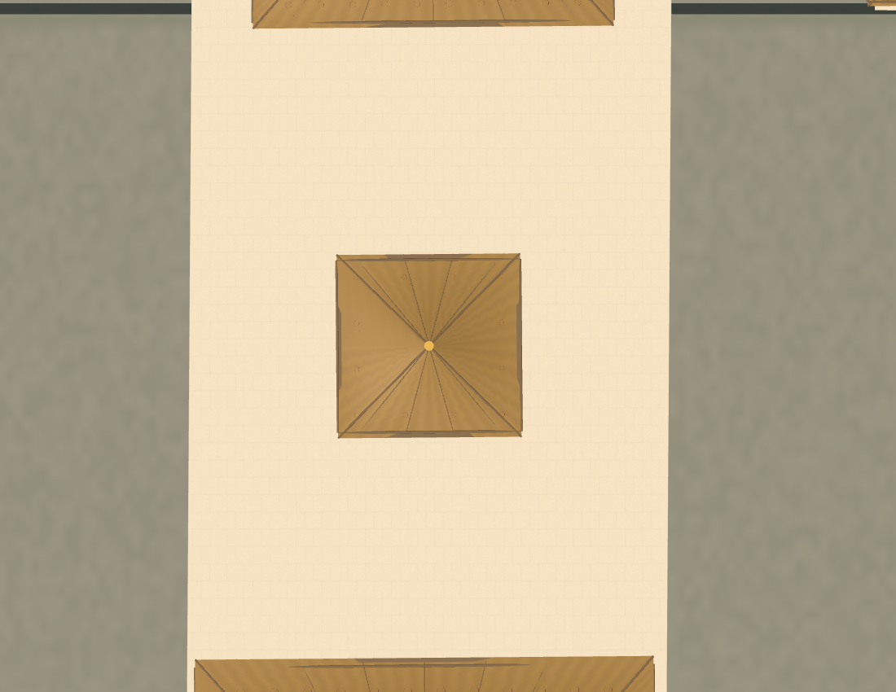

Chromium无头浏览器调用实际 `createLandmark` / `createMaterials` / `bake`，1100×850视口、正交竖向视野10场景单位；前后目标都固定为原中和殿POI的场景位置，Y=0.5，相机相对目标偏移 `[0,50,0.01]`。观察：中和殿横向偏移消除，屋面与相邻主殿采用同一方向。不能据此宣称殿身尺寸、位置或栏杆是测绘复原。

朝向回归在修正前失败（模型为0旋转，宫城基准约0.0083006164弧度）；修正后执行 `npm test -- src/scene/palaceMassing.test.ts src/scene/palacePlatforms.test.ts src/scene/templeLayout.test.ts --maxWorkers=1`，3文件25项通过，覆盖中和殿装配、真实/兜底中心对齐、已有台基和建筑包络。`npm run build`通过，仍有既有Three.js分块超过500kB提示。本轮没有重跑全量测试或整套E2E。隔离俯视渲染的pageerror为0。

- `src/scene/palaceArchitecture.ts` SHA-256：`17763ebe18d32b24953d5775222316f162dbe6125d46cba94352339d927d7e40`。
- `src/scene/precincts.ts` SHA-256：`7731e6e2c259c8483d7a46c77d6b3f58733e04f8264d89292defe6060ae30ce1`。

本轮直接下载核对既有 `PAL-ZHONGHE` 正文，来源总数不变；模型朝向与中心推导说明见[补正记录](../palace-roof-review-2026-11-14.md#中和殿朝向与中心补正)。

实际应用检查：1440×1000下故宫详情达到场景ready、显示故宫标题；随后返回概览切换二维地图，故宫屋面路径正常生成（265419字符），末段中和殿四边形有相应旋转且无NaN。390×844下没有横向溢出，页面错误及console error为0。67条来源ID/URL无重复、目录对应和研究文档本地文件链接检查通过。

## 2026-11-14 · 鼓楼显示轴线对齐

- 对象：用户截图中的鼓楼中门偏在金色轴线右侧；本次左移0.479421729场景单位。隔离模型浏览器计算的中心横向残差由0.479421729变为0，南北位置保持8.909428983（相对钟鼓楼锚点）。
- 对比：[调整前](drum-alignment-before.png)、[调整后](drum-alignment-after.png)；[实际应用页面](drum-alignment-app.png)。均为2026-11-14生成的本项目模型截图，前后对比使用同一相机和隔离背景，不是真实建筑照片或最终参赛验收。
- 验证：`npm run build`通过（保留大于500kB分块提示）；全量`npm test`为118/120，中和殿旧POI位置断言失败、植被测试5秒超时。单独串行运行`minorLandmarks.test.ts`、`geo.test.ts`、`centralGreenery.test.ts`为16/16通过，植被超时未再次出现。中和殿断言对应本轮开始前已有的中和殿中心修改，本次未改该模块。
- 浏览器：实际三维钟鼓楼页正常，二维屋面路径有效，无控制台错误，390×844无横向溢出。现有章节返回/键盘焦点检查通过；全轴自动检查首次和单独复跑均因场景15秒未就绪超时，未通过；未修改测试阈值。实际钟鼓楼页面检查使用60秒就绪等待并成功，不据此宣称15秒加载门槛通过。
- 范围：二维/三维显示位置修正；原始地图快照、钟楼与道路不变。精确实地轴线待补。检查基于包含其他未提交修改的当前工作区，不宣称独立发布版本；共享偏移实现见 `src/scene/bellDrumLayout.ts`。

## 2026-11-14 · 天坛北部、西侧和长廊连接续修

后续截图显示首轮仍遗漏北门两侧、西门附近与西南配房，长廊支路也不对齐。以下是项目模型校核，非实景或历史参考照片，亦非最终比赛验收。

| 检查区域 | 修正前 | 修正后 |
| --- | --- | --- |
| 北门两侧和北天门 | [前](tiantan-north-before.png) | [后](tiantan-north-after.png) |
| 西北独立排房 | [前](tiantan-northwest-before.png) | [后](tiantan-northwest-after.png) |
| 西门、院落与小建筑 | [前](tiantan-west-before.png) | [后](tiantan-west-after.png) |
| 西南配房 | [前](tiantan-southwest-before.png) | [后](tiantan-southwest-after.png) |
| 神厨、宰牲亭及长廊 | [前](tiantan-corridor-before.png) | [后](tiantan-corridor-after.png) |

Chromium独立校核页使用实际 `createLandmark`、`createForest`、`createMaterials` 和 `loadCityData`，1500×1000画布；正交相机相对目标 `[0,85,58]`，目标和垂直视野依次为 `[18,0,-56]/74`、`[-54,0,-37]/50`、`[-62,0,0]/61`、`[-45,0,46]/49`、`[38,0,-21]/23`。修正前由浏览器路由替换为提交 `aa7ba4f` 中的原铺地模块，其他模块和相机保持一致。基底是校核用平面，灯光独立设置，故与主应用色调不同；仅校核铺地、路网和植被相对关系。

观察：北西遗漏群组已有硬地和接路；北附属院落短通道接入长廊，没有旧版横穿廊身的长支路；完整树冠避让新铺装。铺地范围与连接是概览解释，实地路缘、院内绿地、精确门洞和树池仍待补证。主应用另有[桌面](tiantan-access-app.png)、[390×844窄屏](tiantan-access-mobile.png)运行截图；实际测试结果及版本边界见[续修记录](../tiantan-north-west-review-2026-11-14.md)。

## 2026-11-14 · 英华殿东侧院墙走向补正

以下是本项目模型同视角校核图，非真实建筑照片、测绘复原或最终比赛验收。

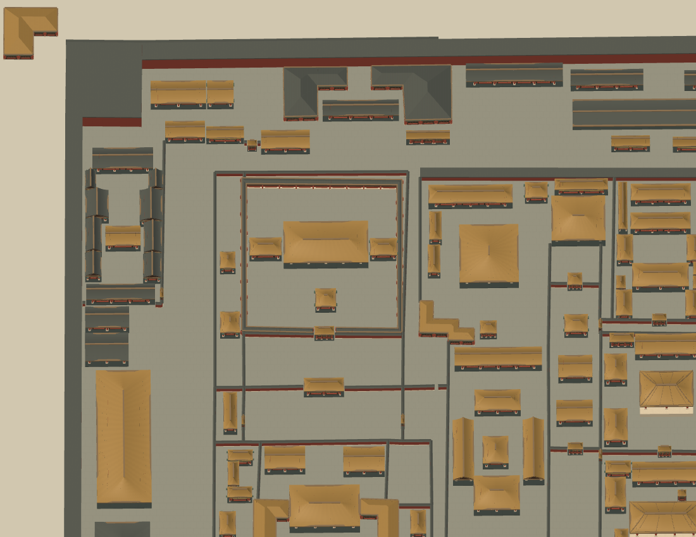

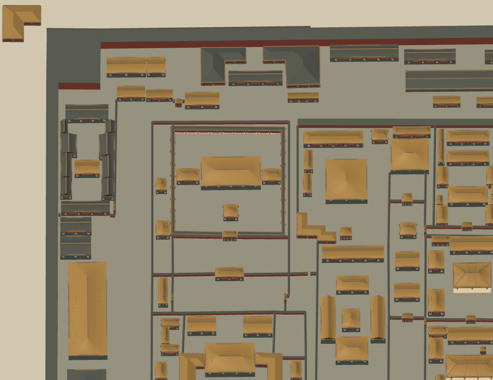

Chromium无头浏览器调用实际createLandmark/createMaterials/bake，1100×850视口、正交竖向视野20场景单位；目标为英华殿way40627060顶点均值的局部位置加 `[1,0.5,1]`，相机相对目标偏移 `[0,50,18]`。前图已包含前项取消建筑裁切退距的改动，故此组专门比较墙线方向。观察：东侧长墙与相邻院墙平行；横墙共享节点相接，南端新增短转折保留原建筑连接点。本图不证明墙线现状实测几何。

验证：围墙、院墙细节、wallRuns三个测试文件7项通过；生产构建通过，仍有既有Three.js分块超过500kB体积提示。未重跑全套E2E或全量测试。局部场景pageerror为0；实际故宫详情1440×1000达到ready、返回概览并切换二维地图成功，390×844无横向溢出，pageerror及console error为0。未据此声明全部warning为0。

本轮仅复核既有本地地图，67条来源ID/URL及目录一致性、本地文档链接已检查；不更新地理快照。`src/scene/palaceWalls.ts` SHA-256：`3d6eee474bc5fe67bd04e5b426bb8ef841d320b5eee9359329e356dcf916667e`。共享工作树另有其他任务修改，本轮未打包提交；最终比赛版本仍须记录提交号。详见[补正记录](../palace-roof-review-2026-11-14.md#英华殿东侧院墙走向及衔接补正)。

## 2026-11-14 · 平台及两侧灰顶回归修复

以下为项目模型截图，非实景、历史照片或最终比赛验收。

| 检查 | 修正前 | 修正后 |
| --- | --- | --- |
| 太和殿前月台、台阶与栏杆 | [前](taihe-platform-regression-before.png) | [后](taihe-platform-regression-after.png) |
| 两侧4段深灰顶 | [前](taihe-side-roofs-before.png) | [后](taihe-side-roofs-after.png) |

Chromium独立本地校核页调用实际 `createLandmark/createMaterials/loadCityData/bake`，1100×850视口。月台视野高度12场景单位，目标为way638449433包围框横向中点、南端向内1.7单位、高0.5，相机偏移 `[-16,15,24]`。两侧图以4段灰顶包围框中心为目标，视野覆盖全宽/深并留8单位，相机偏移 `[0,80,40]`。灯光独立设置，与主应用不同；两侧前图用浏览器路由恢复旧裁切那一行逻辑，其他模块相同。

观察：宽月台不再覆盖金色屋面/门窗；3处前阶及台沿栏杆恢复；4段长条屋面重新为深灰，原侧门与楼阁保留自身屋面。两组浏览器pageerror为0。该比较只验证既有建模规则恢复，不证明现实形制、灰顶各段功能或测绘尺寸。

局部5个测试文件23项通过，生产构建通过，仍有既有Three.js分块超过500kB提示。全量默认并发首次出现3项超时；限制2个worker重跑后共129项，127通过、2失败：中和殿旧POI坐标断言与另一处宫墙裁切断言。初始检查还出现宫墙子组数量断言失败，共享工作区该文件在本轮期间有其他修改，未将这些改动归为本次修复。本轮没有修改上述失败断言，也没有宣称全量通过。

主应用故宫详情1440×1000达到ready并截图：[当前工作区画面](taihe-regression-app.png)；返回概览、二维切换成功，SVG无NaN，390×844无横向溢出；pageerror和console error为0。另跑3项既有Playwright测试，章节iframe返回及焦点恢复通过，概览ready等待与二维切换分别超时，未标为E2E全绿；不把后续手动脚本检查替代既有测试结果。

67条来源ID/URL唯一性、目录对应及本地文档链接存在性已检查。当前基线HEAD为 `cc0ed8d`，包含其他未提交修改，不能视为最终参赛提交；本轮 `palaceCityWalls.ts` SHA-256为 `e5f25c15f46543d07766d5569eb1235b7565084a293a261ebc03ff00ce7589f2`。

## 2026-11-14 · 太和殿前台阶对称补正

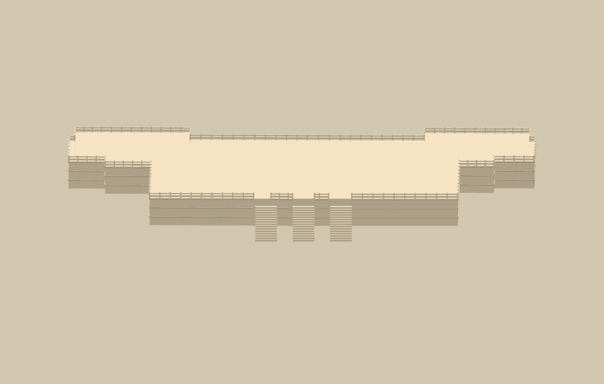

这是项目模型的局部模块校核图，不是实景照片、全应用截图或最终比赛验收。Chromium无头浏览器直接加载本地 `palacePlatforms.ts` 和 `createMaterials`，从南侧略高视角渲染way `638449433`的平台，视口1100×700；浏览器 `pageerror` 为0。三处踏步现为等宽、等进深、等高，并围绕中梯等距布置；台基原地图外轮廓在入口处截断，栏杆开口对应新布局。此轮仅检查正面对称，未发现侧面脱台；图中接合未通过验证，保留为失败阶段记录，由下节侧向复核取代。用户原始附件仅在会话中查看，未归档成仓库中的对比图。

南北平台与栏杆文件7/7项通过，生产构建通过（另有既有Three.js大chunk提示）。关联五文件回归集合为32/33；唯一失败是未改动的中和殿旧POI位置断言与当前工作树中的轴线投影布局冲突，详见[模型复核](../palace-roof-review-2026-11-14.md#太和殿前台阶对称补正)。`git diff --check` 通过。沿用既有 `PAL-TAIHE` / `GEO-OSM` / `GEO-OVERPASS`；未新增来源或改地图快照、坐标系及清单。详见[证据表](../evidence-matrix.md#2026-11-14--太和殿前台阶对称补正)。

## 2026-11-14 · 故宫东南、西南角房屋与外墙线

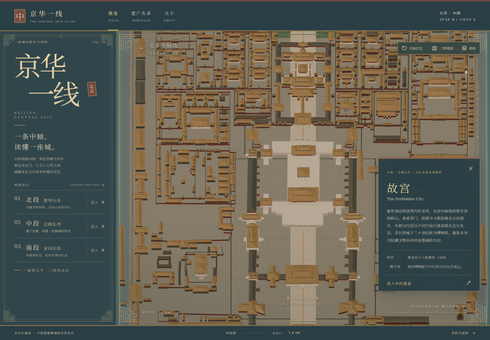

本图由本地Vite页面 `/#/site/forbidden-city` 实际运行生成，Chromium无头模式，1440×1000视口；等待场景加载后滚轮放大查看南侧两角，画面包含宫城南缘及西南、东南周边房屋。它是项目模型截图，不是现场照片或测绘图。13栋房屋来自既有OSM快照；墙线按既有城墙面裁切去重。暗色地表轮廓不能单凭颜色定性为墙体缺失，需在三维和二维图层中结合墙体立面判断。该截图只作当轮视觉检查，未保存前一版本同角度截图，不构成逐段完整性验收或最终比赛证据。

## 2026-11-14 · 台阶脱台侧向复核

以下均为项目模型截图，非实景照片或最终参赛验收。保留同视角前后图，明确更正上一轮仅正面检查的结论。

| 视角 | 修正前（脱台） | 修正后 |
| --- | --- | --- |
| 太和殿前平台侧面 | [前](taihe-stair-side-before.png) | [后](taihe-stair-side-after.png) |
| 太和殿前三组阶梯斜侧面 | [前](taihe-stair-oblique-before.png) | [后](taihe-stair-oblique-after.png) |

北向平台：[侧面](baohe-stair-side-after.png)、[斜侧面](baohe-stair-oblique-after.png)。太和殿前[实际总装斜侧面](taihe-stair-assembly-after.png)另调用 `createLandmark/createMaterials/loadCityData/bake`，确认并入殿宇模型后仍相接。

局部图由Chromium载入本地 `palacePlatform` 与实际石材生成，1100×700视口、正交竖向跨度3.6。目标为way638449433局部包络x中点、高0.4、最南端向内0.9，相机偏移侧面 `[16,3,0]`、斜侧面 `[8,5,12]`；北平台way638467894取最北端向内0.9，斜侧面偏移 `[-8,5,-12]`。总装图1100×850、竖向跨度5，目标x为南平台包络中点、高0.5、最南端向内1.7，相机偏移 `[12,6,18]`。各组pageerror均为0。观察：楼梯延伸完整行程，顶端有连续石面连接平台，通道内无横栏；仍不证明精确历史节点。

此轮沿用 `PAL-TAIHE` / `GEO-OSM` / `GEO-OVERPASS`，只本地复核，不更新地理快照或核验日期。来源目录、登记与方法同步说明模型参数；测试与构建结果见[本轮复核](../palace-roof-review-2026-11-14.md#台阶脱离平台的侧向复核与修正)。

本轮相关4文件24项测试通过（台基文件9项），生产构建重跑通过，仍有Three.js分块超过500kB提示。主应用1440×1000/390×844无pageerror、console error或窄屏横向溢出。71条来源ID/URL唯一且均在目录，研究文档本地文件链接及11个既有快照字节数/哈希检查通过；未跑全套单测/E2E。当前为 `cc0ed8d` 基线加共享未提交工作，台基源码SHA-256为 `75e5204f46e27e82edbdf524d2288bed0af51a687c4404d534c244ceed60a9a2`，截图是本轮纠错记录，不是最终比赛验收。

## 2026-11-14 · 午门神武门衔接与神武门正面对称

以下均为本项目模型的阶段校核图，不是实景照片、测绘复原或最终比赛验收。

| 检查对象 | 修正前 | 修正后 |
| --- | --- | --- |
| 午门门台与外墙接口 | [前](wumen-connection-before.png) | [后](wumen-connection-after.png) |
| 神武门门台与外墙接口 | [前](shenwumen-connection-before.png) | [后](shenwumen-connection-after.png) |
| 神武门外两组建筑与中门导览线 | [前](shenwumen-front-before.png) | [后](shenwumen-front-after.png) |

前两组由Chromium本地校核页调用实际 `createLandmark/createMaterials/loadCityData/bake`，1200×800视口；午门/神武门正交视野高度分别19/10场景单位，目标为源轮廓包络中心、高1，相机偏移分别 `[9,12,18]` / `[9,12,-18]`。它们记录门台衔接阶段，早于最后的门外对称与轴线修正，不应作为后两项的前后比较。

正面一组为1300×800视口、12单位正交竖向视野，相机沿门楼朝向位于门北30单位、高9，朝门心高1；修正前只通过本地模块路由关闭门外成对显示和局部轴线函数，宫门结构保持相同。观察：两侧小门房、长廊成对等距，中轴金线经过中央券洞，并在门心前后30—70米之间接回原线。截图与多点射线测试共同检查通行，前视图本身不能证明洞内所有空间。局部校核页面未记录pageerror；独立灯光与主应用不同。

[主应用二维检查截图](palace-gates-app-map.png)使用1100×760视口；故宫详情达到ready后，以键盘Enter切换二维地图，屋面与轴线路径有值且无NaN；随后390×844无横向溢出，中部章节iframe返回先前故宫详情并恢复品牌焦点。最终脚本pageerror/console error均为0。初次鼠标点击二维按钮被详情面板遮挡而超时，此轮未修改该布局；另一次脚本错误期待返回根路由，而应用按既有约定返回所选故宫详情，修正脚本断言后通过。二维加载前产生孤立 `M` 路径的错误已修正并复查。

2026-11-14最后相关回归9文件38项，37通过、1失败：`palaceCityWalls.test.ts`合批子网格数量实际24，断言要求小于12；本轮未放宽该断言。宫门3项、局部轴线2项均通过，包括中央券洞射线与范围外点不变。生产构建重跑通过（1638模块），Three.js分块539.69kB仍触发既有500kB提示。既有全套Playwright为1通过、4失败：章节独立访问及返回通过，三个场景ready等待超时，天坛用例总超时；不以补充脚本替代全套E2E结果。

71条来源ID/URL唯一、均有目录条目；研究文档本地链接有效，11个既有快照大小与SHA-256匹配。没有修改地理快照或全图投影。基线HEAD为 `cc0ed8d55275c06e2b3542862e834acf157314d0`，共享树还含其他任务未提交修改，未打包提交；最终比赛版仍须固定提交号并重新验收。本轮源码指纹：

- `src/scene/palaceGates.ts`：`26e91eac0b70432c8ec6c7b92104cfeb848184e59c6c20f45b513c2faf1d2be3`
- `src/scene/axisRoute.ts`：`b56b8801f3e036da52471c4bd4a02297254ac1873340d16fd0815849c0c9e3b3`

依据与局限详见[宫门研究记录](../palace-roof-review-2026-11-14.md#午门神武门衔接与门外对称修正)。官方文字、地图几何、用户指定的对称化/导览线移位分别记录；券洞尺寸、短坡和檐口标高仍为概览参数，未复原两掖门、钟鼓亭、详细马道与神武门栏杆节点。

## 2026-11-14 · 万宁桥镇水兽

以同日工作树生成的项目模型，非现实照片或最终参赛验收。旧四尊小型兽形由六尊替换：文物局 `BRIDGE-HERITAGE` 明确西四东二，市政府 `BRIDGE-CITY` 的四尊概述并列保留。西侧上下分层、东侧朝桥孔；雕刻、尺寸、岸座和逐尊位置为简化解释，完整侧挂姿态和现状测绘仍待补。没有复制外部图片。

| 检查对象 | 本地模型图 |
| --- | --- |
| 原四尊简化表达（本轮已取代） | [修改前桥西](wanning-west-before.png) |
| 西侧上下两层与通水孔 | [修改后桥西](wanning-west-after.png) |
| 东侧两尊与桥孔朝向 | [修改后桥东](wanning-east-after.png) |
| 单尊龙首、伏爪与卷尾 | [石兽细节](wanning-detail-after.png) |
| 主应用万宁桥详情 | [应用运行截图](wanning-app-after.png) |

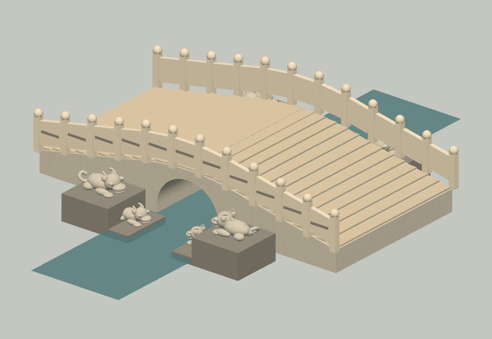

隔离三视角为Chromium 1100×760正交渲染，使用项目 `createWanning` / `bake` / `createMaterials`；桥体归零后从西/东斜侧观察，单尊视角仅为构件检查。隔离图水带是校核背景，不是运行时真实河道。模型六尊，无pageerror/console error，西侧低层石兽可能被前方高岸座局部遮挡，不能仅凭一个画面判断数量。主应用1440×1000加载万宁桥详情达到ready，Tab到“京华一线，返回总览”链接；390×844无横向溢出，pageerror/console error为0。

实际验证：两文件11项针对检查通过，构建通过（Three.js分块仍大于500kB），北区示例iframe返回与焦点恢复E2E 1项通过。首次全量测试143通过/15失败，含已修正的万宁桥旧四尊预期，以及其他模块超时/断言失败，未声称全套通过；详见[本轮记录](../wanning-guardians-review-2026-11-14.md)。来源仍71条，未修改地理快照。本轮工作树未固化为独立提交。

## 2026-11-14 · 天坛两重坛墙与附属院落墙

以下为本项目模型同路线校核图，非现实照片、测绘复原或最终比赛验收。`before`为1280×960主应用 `/#/site/tiantan`，显示此前无坛墙、双环亭前坪斜置；`after`使用同一视口和路线。近景图为1440×1000场景就绪后滚轮放大，专门检查内坛北弧不再穿过双环亭与北宰牲亭。

| 检查对象 | 修正前 | 修正后 |
| --- | --- | --- |
| 天坛全园两重坛墙与院落墙 | [前](tiantan-walls-before.png) | [后](tiantan-walls-after.png) |
| 内坛北弧穿建筑纠错 | — | [近景](tiantan-walls-close-after.png) |

观察：外坛墙沿当前公园外环闭合，内坛墙形成北圆南方轮廓并在七门位置留口；外坛墙灰瓦、内坛与隔墙绿色檐口、附属院落红墙绿瓦。首轮北弧在双环亭和北宰牲亭处穿过建筑，近景图记录修正后的分离状态，建筑裁切和回归检查另行覆盖。外坛当前边界含近代收缩与缺失段，内坛圆弧、院墙厚度、墙帽节点与门楼立面均为导览解释，不能凭截图宣称现状精确复原。

依据、失败查询和实现边界见[坛墙专题记录](../tiantan-wall-review-2026-11-14.md)。

## 2026-11-14 · 故宫内墙排布与内务府续修

本组为本项目工作树模型校核图，非现实照片、实测复原或最终比赛验收。用户示意图及圈注仅保留于忽略目录作本地对照，原作者与许可待核，不在此转载。来源和取舍见[专题记录](../palace-wall-layout-review-2026-11-14.md)。

| 对象 | 本轮校核图 |
| --- | --- |
| 宫内墙线与独立短构件 | [全宫俯视](palace-wall-layout-full-after.png) |
| 内务府南侧整排墙与房身接口 | [放大斜视](palace-wall-layout-row-after.png)、[周边关系](palace-wall-layout-row-context-after.png) |
| 内务府屋面细节、右侧向北接墙 | [局部俯视](palace-wall-layout-neiwufu-after.png) |
| 东侧服务房屋的墙端 | [接楼局部](palace-wall-layout-east-after.png) |
| 故宫详情实际页面 | [主应用](palace-wall-layout-app-after.png) |

隔离视图为Chromium/SwiftShader调用项目实际 `createLandmark`、`createMaterials`、`bake` 生成，1300×1500视口、独立校核灯光。正交相机目标高度0.4；全宫中心(0,0)、半视野55、高130俯视；整排放大目标(-26,18)、半视野6、相机偏移(12,20,-22)，展示图裁取原画面(0,490)—(1300,1060)；周边视图目标(-22,7)、半视野12、同偏移。内务府目标(-19,12)、半视野9、偏移(0,35,8)；东侧目标(22,12)、半视野7、偏移(12,18,25)。坐标均为场景参数，不是地理测量。

观察：原本掠过整排檐边的墙条移至房屋接口之间；内务府右侧院界向北与既有节点相接，楼下原短尾撤去；凹形屋面已有脊、檐边及顺坡细线。独立短构件仍保持独立。不能据单一视角断言所有构件无交叠，实体接楼、墙帽避让和拓扑检查另见专题记录；屋顶完整现状形制、精确院界和尺寸仍待补证。

主应用检查1440×1000及390×844，故宫详情达到ready约15.9秒；无页面错误、控制台错误/警告及失败请求，手机宽度无横向溢出。键盘Enter切至二维地图后墙线路径有效。隔离图1234栋既有建筑检查无缺项、无pageerror，362段檐下接楼线。

本组对应10文件64项及墙帽/外柱2项回归通过、生产构建通过；未重跑最终全套单测/E2E。源码指纹、早期失败和现有缺失文档链接在[专题收尾记录](../palace-wall-layout-review-2026-11-14.md#本轮收尾结果)列明。基线 `cc0ed8d` 加共享未提交修改，最终比赛提交号待固定。

## 2026-11-14 · 东侧四栋房屋柱廊接墙二次复核

[修正前](palace-east-veranda-before.png)、[修正后](palace-east-veranda-after.png)、[同角度对照](palace-east-veranda-comparison.png)。均为本项目模型，生成于2026-11-14，非现场照片或最终比赛验收。前图替换任务开始时备份的palaceWalls模块，其他模块同用当前工作树；不是完整历史版本。

Chromium/SwiftShader，1300×1500；相机目标(21,0.4,12)、半视野5.8、偏移(-12,20,-25)，图裁取(210,530)—(1210,1040)，两版同灯光。观察：原伸入柱廊窗面的短返墙退至外柱，墙帽单独止住，连接仍保留；其他正侧面亦作本地复查。有限视角不证明所有构件全无交叠，精确立面和接墙节点仍待补。原因、21项相关回归、全量太庙1项失败及版本限制见[记录](../palace-collision-review-2026-11-14.md)。

## 2026-11-14 · 乾清宫前白石平台

以下为本项目模型校核图，非真实建筑照片或最终比赛验收图。用户反馈中殿前月台及长甬路被误绘为金顶；本轮按 `PAL-QIANQING` 官方文字与既有地图轮廓改为白石台面，甬路两端及与月台的共边留通口。

| 视图 | 修改前 | 修改后 |
| --- | --- | --- |
| 乾清宫前月台和高台甬路 | [原误绘金顶](qianqing-platform-before.png) | [白石平台](qianqing-platform-after.png) |
| 月台接口及材质 | — | [局部](qianqing-platform-detail-after.png)、[近俯视](qianqing-platform-top-after.png) |

Chromium/SwiftShader使用项目 `createLandmark/createMaterials/bake`，1300×1500视口及独立校核灯光；正交相机目标为月台轮廓包络中心(-0.0375,-23.1924)，高度0.4，半视野6、偏移(3,14,18)；近俯视半视野5.5、偏移(0,25,8)。局部图由斜视原图裁取(180,300)—(1150,1100)。未转载外部照片。两块顶面0.20单位、层缝和栏杆属示意；此图不证明台阶及所有细节点的现状精确性。

本轮4文件35项回归通过、构建通过（仍有既有500kB分块提示）。资料层级、实际浏览器结果和版本指纹见[专题记录](../qianqing-platform-review-2026-11-14.md)。

## 2026-11-14 · 故宫花园与侧桥

自制模型校核图，2026-11-14生成，基准HEAD `cc0ed8d55275c06e2b3542862e834acf157314d0`加本轮未提交工作区；不是实景照片或最终发布验收。真实本地水面加载后检查四园范围、屋檐净距、保留铺地与九座侧桥。园界、种植形状、树位和桥细节为导览解释，完整现状还原待补；详细证据及实际验证见[本轮记录](../palace-landscape-review-2026-11-14.md)。

- [全宫俯视](palace-landscape-overview.png)
- [御花园与周边房屋](palace-landscape-imperial.png)
- [慈宁宫花园](palace-landscape-cining.png)
- [建福宫花园局部](palace-landscape-jianfu.png)
- [宁寿宫花园局部](palace-landscape-ningshou.png)
- [太和门、武英门与文华殿桥群](palace-landscape-bridges.png)

- 主应用独立复查：1280×800 / 390×844，无横向溢出，键盘切换二维成功；页面错误、控制台警告、请求失败均0。首次与隔离渲染并发截图超时，独立复查后通过。
- [主应用桌面](palace-landscape-app-after.png) / [手机窄屏](palace-landscape-app-mobile-after.png) / [二维图](palace-landscape-app-flat-after.png)

## 2026-11-14 · 其他疑似穿模圈选复核

本项目模型截图，生成日期2026-11-14，非实景照片、测绘或最终比赛验收。

| 检查组 | 图像 |
| --- | --- |
| 凹形小屋立面旁重复墙段 | [前](palace-more-concave-before.png)、[后](palace-more-concave-after.png)、[对照](palace-more-concave-comparison.png) |
| 中下部左侧短返墙 | [前](palace-more-service-before.png)、[后](palace-more-service-after.png) |
| 右侧长房短返墙 | [前](palace-more-east-before.png)、[后](palace-more-east-after.png) |
| 下部小屋周边 | [前](palace-more-south-row-before.png)、[后](palace-more-south-row-after.png) |
| 下部三小屋接头及上侧横房近景 | [三小屋](palace-more-three-huts-after.png)、[横房](palace-more-upper-house-after.png)、[修正近景合图](palace-more-contacts-after.png) |

Chromium/SwiftShader，1300×1500，项目实际createLandmark/createMaterials/bake。相机目标高度0.4：凹形房中心(18.6,8.5)、半视野2、偏移(-8,12,12)；左侧组中心(23,19.5)、半视野6、偏移(-12,16,-18)；右侧组中心(34,18)、同视野/偏移；下部周边中心(25,20.5)、半视野3、偏移(-12,12,-22)。凹形房前图仅替换本轮开始备份的墙线模块，其他模块同当前工作树；其余前图为本轮修改前生成。共享工作树有同期变更，不能视为完整历史版本对比。

观察：凹形立面上重叠的院墙已裁断到立面外，六栋新增接点由窗面改至外柱；多处圈选仅为屋檐遮住正常接墙，保留其原关系。截图和有限射线不能证明整个故宫绝无交叠。逐组对象、测试及尚失败的花园/太庙检查见[补充记录](../palace-collision-more-review-2026-11-14.md)。

本组追加近景：三小屋目标(28.4,0.4,20.68)、半视野1.8；横房目标(28.54,0.4,6.35)、半视野2.1，均偏移(-6,7,10)。合图裁取各近景用于展示，不充当完整场景检查。

## 2026-11-14 · 文华殿东北绿地与石板路

本项目模型截图，非实景照片、测绘图或最终比赛验收。基准HEAD与共享脏工作树、用户来源、参数解释和实际检查详见[本轮记录](../palace-court-landscape-review-2026-11-14.md)。

- [最终俯视局部](palace-court-top-after.png) / [最终斜视局部](palace-court-oblique-after.png)：1300×1500，Chromium/SwiftShader；目标(28.5,0.4,12.8)，俯视半视野12、相机相对偏移(0,80,0)，斜视半视野10、偏移(0,25,15)。实际建筑、水面及墙线参与渲染；分块种植与石板可见，影壁独立，西界收进原院墙。
- [桌面](palace-court-app-after.png) / [窄屏](palace-court-mobile-after.png) / [二维](palace-court-flat-after.png)：1280×800及390×844，键盘切换二维成功；零页面错误、警告与请求失败。主应用图在最后移除底部细小绿带前生成，局部图为之后结果。

道路、树木与外边缘仍为概览解释；不能通过截图证明真实遗产现状或全宫完全无交叠。

## 2026-11-14 · 东西华门城台与门楼

以下为此前工作树保存的项目模型图，不是实景照片。本轮仅补齐缺失的图册索引，未重新生成图片；原始生成提交与完整相机元数据未随图片保存，不能当作本轮视觉验收。

| 对象 | 正面 / 内侧 | 斜侧面 |
| --- | --- | --- |
| 东华门 | [正面](donghuamen-front-after.png)、[内侧](donghuamen-inside-after.png) | [斜侧](donghuamen-oblique-after.png) |
| 西华门 | [正面](xihuamen-front-after.png)、[内侧](xihuamen-inside-after.png) | [斜侧](xihuamen-oblique-after.png) |

图片对应城台、门楼、门洞与接墙的局部观察。事实、推估尺寸和图片授权边界见 [专题记录](../palace-side-gates-review-2026-11-14.md)。本轮构建与未执行检查见 [进度记录](../../progress.md)。

## 2026-11-14 · 故宫内部房屋与短墙断口

以下保留此前工作树的模型图：[整体俯视](palace-interior-top-after.png)、[二维地图](palace-interior-flat-after.png)、[武英殿](palace-interior-wuying-after.png)、[文华殿](palace-interior-wenhua-after.png)、[应用画面](palace-interior-app-after.png)。这些是项目模型而非现实参考照片；本轮未重新截图或验证相机参数。

图中早期近邻自动补墙不能作为当前院墙排布结论，后续已有 [显式排布纠错](../palace-wall-layout-review-2026-11-14.md)。殿廊分部和资料边界见 [内部专题](../palace-interior-review-2026-11-14.md)。旧图保留研究过程，不标记为本次交付最终验收。

## 2026-11-15 · 南至北三维游览

项目模型检查图：[800px桌面暂停画面](2026-11-15-axis-tour/desktop.png)、[390px手机布局检查](2026-11-15-axis-tour/mobile-earlier-framing.png)。两图均为本项目软件WebGL截图，不是现实参考照片或用户验收。桌面图使用本轮最终近景范围；手机图来自稍早、较远的相机范围，仅用于确认控件、停留卡与页面布局。检查观察为按钮、站点及进度可见，手机没有横向溢出；没有据此声称完整路线每站遮挡均已验收。版本与实际命令见[进度记录](../../progress.md)本轮条目，路线和证据边界见[游览记录](../axis-tour-2026-11-15.md)。

### 2026-11-16 · 游览37度与提速

[37°游览南段模型图](2026-11-15-axis-tour/tour-37deg.png)：800×600本地Chromium，读取相机与目标位移核算俯角为37°，无pageerror；静态截图仅核查南段画面与暂停状态，不证明全路线无遮挡或速度体验已人工验收。游览速度与停留参数及研究边界见[更新记录](../axis-tour-2026-11-15.md#2026-11-16--游览视角放平与提速)。

## 2026-11-16 · 故宫内部名称标记

[故宫聚焦画面](2026-11-16-palace-labels/focused-palace.png)：本项目模型，1000×760本地Chromium。观察到太和门、太和殿、保和殿、乾清宫、坤宁宫、午门等标签可见；中和殿、交泰殿等因名称碰撞在此范围隐藏。截图为聚焦检查，不是实景照片、完整游览验收或所有标记同时可见的证明。详见[本轮记录](../axis-tour-2026-11-15.md#2026-11-16--故宫内部建筑名称标记)。

同轮[手机紧凑游览面板](2026-11-16-palace-labels/compact-mobile.png)：390×844本地模型截图，移除自动地点长介绍后面板高度约99.4px，保留名称、站次与进度。320px视口复查同样无横向溢出、无pageerror；不作为全程游览验收。

## 2026-11-16 · 天安门、端门标签下移

项目模型聚焦截图：[天安门](2026-11-16-gate-labels/tiananmen.png)、[端门](2026-11-16-gate-labels/duanmen.png)。900×700本地Chromium、减少动态效果；两处标签靠近城楼且opacity为1，无pageerror。仅校核两个聚焦画面，不是现实照片或完整游览验收。
