# 模型校核图册

归档日期：2026-11-13。这些是本项目自制模型的中途校核截图，来自已有本地渲染；本次只保存文件，未重新启动浏览器生成截图。它们不是真实建筑照片，不替代外部来源、历史资料或测绘成果。

截图来自当轮不同阶段，最新代码可能已继续变化；最终比赛版应重新截图并记录提交号、视口和相机。此处保留问题与修正的研究证据，不把中途画面称为最终成品。

## 万宁桥俯视桥位校核

桥身与既有道路同向，覆盖实际水道；标签POI与物理桥心分别处理。此图校核相对位置，不能证明每一石构件实测准确。

## 护城河树列校核

树列移至河岸，保留实际水面。此图记录修正后的局部空间关系，不构成植被历史复原。

## 小型房屋立面校核

相较空白红块，小屋使用独立柱、窗棂和檐底。只是被抽查的一组，不表示全图小建筑已排查完成。

## 钟楼形制校核

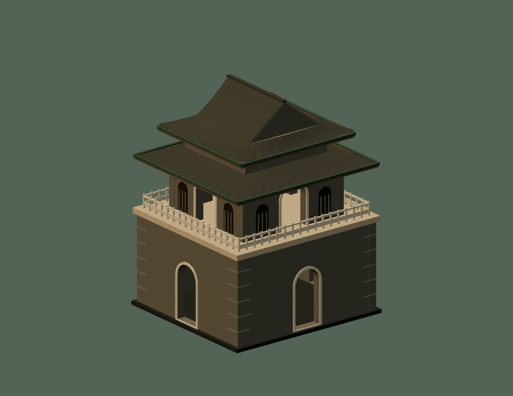

检查灰砖石主体、开敞券洞和两重屋顶；构件、台阶及钟体仍有概化。

## 鼓楼形制校核

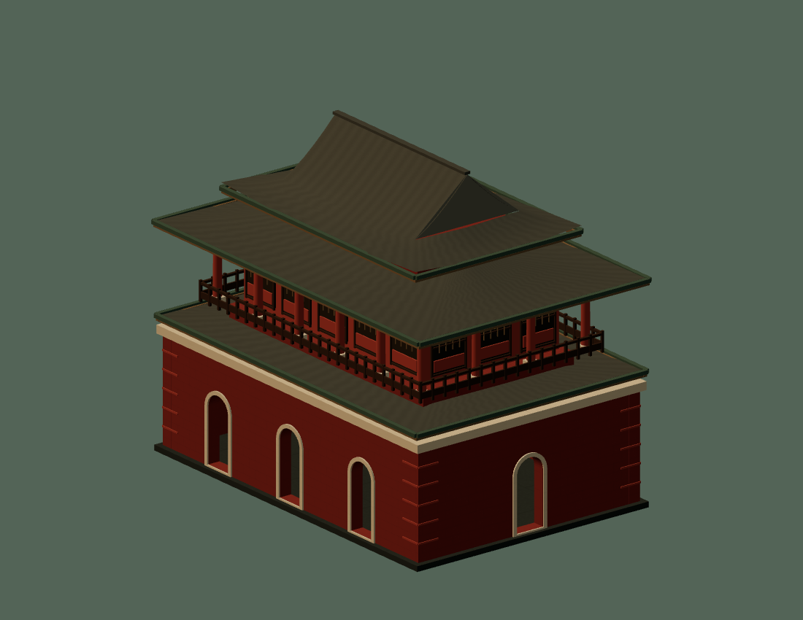

检查红台基、木构上层和三重檐的区别；不将图作为原建筑照片。

## 先农坛建筑群校核

展示本轮扩展的主要殿院和神厨、神仓、庆成宫；新增院落包络是解释性布局，非测绘图。

## 祈谷坛院墙校核

检查实际建筑边界裁切后，院墙不再被长廊外接矩形大段抹除；此图不代表全院细部最终验收。

## 2026-11-14 · 正阳门体量比例校核

以下三张为本轮新生成的项目模型截图，非真实建筑照片。源于基准提交 `c1eb21cace3770f81d35214570624930e7268f52` 上的未提交工作树；不称最终比赛交付。截图生成日期为2026-11-14。

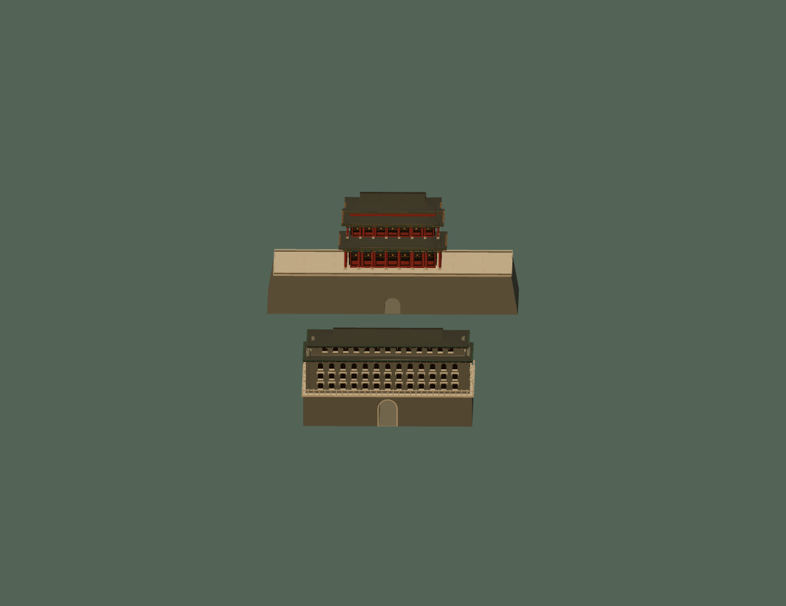

前后局部图使用同一1100×850视口、23场景单位正交视野、相机相对目标偏移 `[0,13,40]`，以建筑组合包络中心为目标；使用实际 `createLandmark`、`createMaterials` 和 `bake`，临时隔离页面检查几何与比例。观察：城台不再过宽过浅，夸张栏柱去除，两层木构与三道檐口更易分辨。此图只支持模型前后比较，不能作为工程尺寸或现状照片。

实际应用 `/#/site/zhengyang`，Chromium无头浏览器，1440×1000视口；场景达到ready、详情显示正阳门后截图。该截图可能处于相机过渡中，不用作精确视角对比。之后切换二维地图，确认正阳门屋面SVG路径生成（875字符）；390×844下无横向溢出；页面错误与console error合计0。局部隔离渲染出现多份Three.js导入提示及软件GPU读像素提示，未将该隔离脚本称为无任何警告。

验证命令与实际结果：`npm test -- src/scene/zhengyang.test.ts src/scene/bake.test.ts`，2文件5项通过；`npm run build`通过，保留既有Three.js分块超过500kB的体积提示。本轮没有重新执行全套E2E，也没有以本轮检查代替暂停中的其他地标验收。

对应证据：`ZHENGYANG-FIRE-2020` PDF第2页、`ZHENGYANG-CENTER`；见[证据表第11项](../evidence-matrix.md#11--正阳门-zhengyang)。以下指纹标识本次截图所用关键源码，不代替最终提交号：

- `src/scene/architecture.ts` SHA-256：`acb1e920768a0af2ed628dcf6d78a61d0cc238da6a0683d7271a5ebbab87928c`。
- `src/scene/zhengyangLayout.ts` SHA-256：`6e70572ecde96c90a77cb518710ec2ee10b81824de7f959c95776e2534789a57`。
- `src/components/FlatMap.tsx` SHA-256：`6add6887f51269e40d5a47bbac00d2069b30b3a731da368728470d86687fead6`。
- `src/scene/cityPlan.ts` SHA-256：`d7a6684c7bbbd984616f37d7cc6a1117c6de33f97dfa5a2b71205a2a1a707897`。

## 2026-11-14 · 广场北侧铺地衔接

以下为项目模型的同视角对比，非现实照片，也非最终比赛验收。工作树基准为 `c1eb21cace3770f81d35214570624930e7268f52`，本轮在 `codex/axis-atlas` 修改；工作区还包含其他未提交改动，故以关键文件指纹标识本次修正。

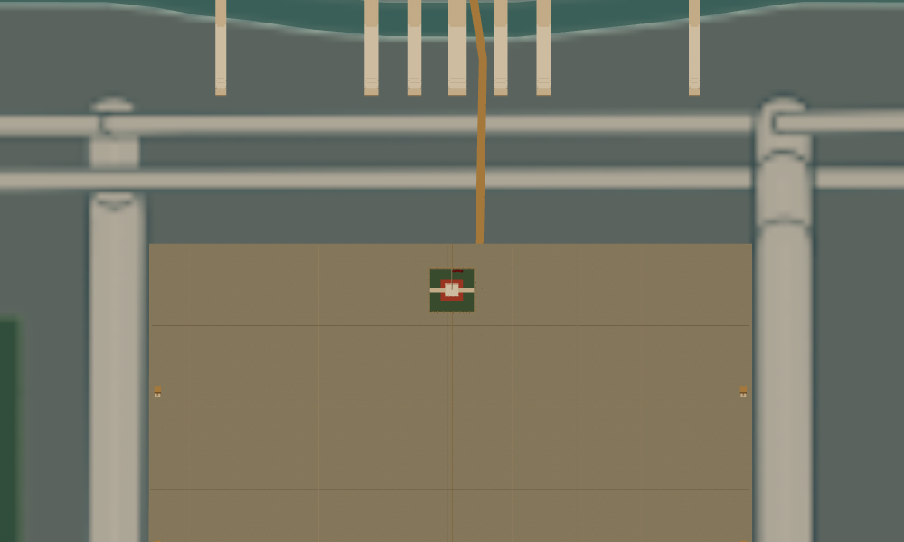

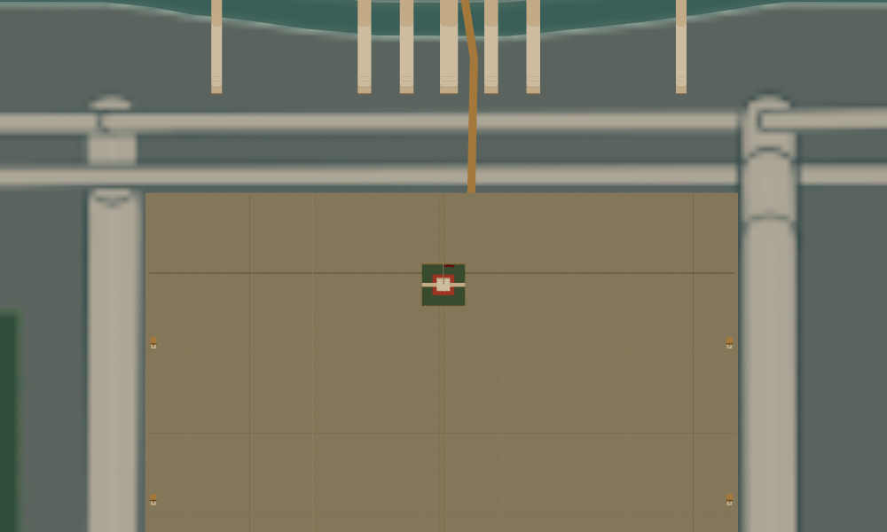

两图均由Chromium无头浏览器调用实际 `createCity` / `createMaterials` / `loadCityData` 渲染，使用1000×600画布、42×25.2场景单位正交视野；旗杆投影为 `[x,z]`，相机 `[x,100,z+32]` 朝向 `[x,0,z-1]`。观察：长安街南侧空带消除，保留道路边缘余量、旗台与东西侧道路；铺地北界在当前模型中向北延伸约23.1m。仅验证场景几何衔接，不能证明实际路宽或保护界线。

实际应用 `/#/site/square`，1440×1000视口，启用减少动态效果并在场景ready后截图。前后两次页面与局部渲染的pageerror/console error均为0；不据此宣称所有警告为0。

验证：`npm test -- src/scene/squareGround.test.ts src/scene/environmentDetails.test.ts`，2文件5项通过。新增测试修正前失败（道路与铺地间约25m空带），修正后通过；检查北边西端、中轴、东端道路余量与二维共享铺地。`npm run build`最终通过，仍有既有Three.js分块大于500kB提示。首次构建遇到同时编辑中的景山测试签名错误和本轮测试Node类型导入错误；本轮导入已改用Vite原始文本，景山由其工作区改动完成后，第二次构建通过。

资料验证：49个来源ID及URL无重复、目录ID对应、研究文档本地链接有效、清单中全部数据文件字节数及SHA-256一致。此次只核验既有本地OSM快照，无新增来源或外部照片。对应 `GEO-OVERPASS` / `GEO-OSM` 和[证据表第10项](../evidence-matrix.md#10--天安门广场及建筑群-square)。

- `src/scene/squareGround.ts` SHA-256：`737ec7300a31f08235148f76f88ffc0922ed8364903ed5f8b157229535342cf6`。
- `src/scene/squareGround.test.ts` SHA-256：`4d65c64ca49acb97fd36384c89615cd5143431e0faf1da295f4ac7d662ebc6af`。

完整现有浏览器回归：`npx playwright test`，3项通过、2项失败。广场详情及辅助地标、二维地图、iframe返回与焦点检查通过；总览溢出检查和旋转/平移检查均在等待 `.scene-world.is-ready` 时超过15秒，尚未执行到各自后续断言。此处保留失败，不调整测试时限或将整套标为通过。

补充窄屏检查：实际广场详情页390×844，场景ready后无横向溢出，pageerror/console error为0；等待上限60秒，独立执行，不替代上述15秒加载回归失败。截图：[窄屏广场详情](square-north-mobile.png)。

## 2026-11-14 · 正阳门细节回补

本轮新生成的自制模型校核图，不是真实建筑照片。基准提交仍为 `c1eb21cace3770f81d35214570624930e7268f52`，实际使用其上的未提交工作树；其他模块同期仍有改动，未打包提交，以免混入其他工作。

原始全幅：[调整前](zhengyang-detail-before.png)、[回补后](zhengyang-detail-after.png)。局部隔离渲染使用1100×850视口、11场景单位正交视野、相机相对城楼包络中心偏移 `[8,8,40]`；实际调用 `createLandmark`、`createMaterials`、`bake`。对比图仅对这两张同视角截图作同范围裁剪、并排和文字标注，没有改变模型内容。

观察：三道屋面的瓦垄、绿色边脊与山面边线恢复可见；砌筑缝随城台收分贴合；券洞边缘分块，上层回廊补低栏杆和楼板边。保留三重檐、两层木构及校正后的城台比例。图中砖缝、瓦垄抽样、券边分块与栏杆均为模型解释，不作实测构件或完整历史复原证据。

实际检查：

- `npm test -- src/scene/zhengyang.test.ts src/scene/zhengyangDetails.test.ts src/scene/bake.test.ts`：3文件7项通过，包括原有包络与总高、三重屋面细节、合批后门洞多点双向射线畅通、合批数量约束。新增2项在修复前失败、修复后通过。
- `npm run build`：本轮通过；保留Three.js分块超过500kB的体积提醒。后续共享工作树又有其他模块新增，因此此结果只说明当次构建，不代表同期所有工作完成。
- 局部截图已目视对照。隔离渲染脚本有多份Three.js导入提示及软件GPU读像素提示，未称其为无警告环境。
- `npm test` 全套首轮87项通过、2项在5秒限制下超时；限2个worker复跑时，工作树新增的 `centralGreenery.test.ts` 引用了当时尚不存在的模块，另有8项故宫体量测试失败，89项通过。未修改这些测试或削弱断言，未声称整仓单测全绿。
- `npx playwright test`：1项章节返回/焦点检查通过、4项失败，其中3项未在15秒内达到scene ready，1项拖动操作超时。未扩大默认超时以宣称通过；保留该轮未通过状态。
- 来源登记共49个唯一ID/URL，正阳门两来源在目录与证据表中均可对应；`git diff --check`通过。未更换地理数据，数据快照清单无需重算。

下列文件指纹标识细节修复，不能替代最终交付提交号：

- `src/scene/architecture.ts` SHA-256：`7462d372d8c8633b8465f40beb07d72cc73eebe9f53ceb67b384fcb8ca5574b9`。
- `src/scene/zhengyangDetails.ts` SHA-256：`d1f4083552a6d13a58020d4207761a256a3da7e3f828a2f6bc271b97c6e4ea01`。
- `src/scene/zhengyangDetails.test.ts` SHA-256：`fd0b0f9487bc5116a8f6392a84cce4ed6ffa9d22f9437c9a09fd8398bc1653d6`。
- `src/scene/zhengyangLayout.ts` SHA-256：`6e70572ecde96c90a77cb518710ec2ee10b81824de7f959c95776e2534789a57`。

## 2026-11-14 · 景山山体占路修正

以下为本项目模型运行截图，不是真实地貌或现状测绘照片。基准提交仍为 `c1eb21cace3770f81d35214570624930e7268f52` 加未提交工作树；用于本轮局部问题复核，不作为最终比赛验收。

局部全城场景检查使用 `createCity`、真实本地地图数据和实际材质；1100×850视口。前后侧视的正交视野均为57场景单位，相机相对目标偏移 `[10,22,50]`；俯视为60场景单位、偏移 `[0,100,0.001]`，目标GCJ-02 `[116.3969,39.9251]`。观察：西侧、南侧道路及其边缘重新露出，山体与坡脚步道收在园内；树冠避让园界。图中的形状仍为程序山势，不能用它证明山脚线、树种数量或坡度测量准确。

实际应用检查：Chromium无头浏览器，1440×1000，路由 `/#/site/jingshan`，本次等待ready约5323ms，页面错误及console error合计0；随后切换二维地图，景山屋面SVG路径正常生成（15703字符）；390×844无横向溢出。临时脚本起初按容器可见性等待超时，但容器已具有is-ready类且截图已正常渲染；最终按项目既有ready状态约定检查，未扩大15s期限。

实际验证：`npm test -- --maxWorkers=1 src/scene/jingshanTerrain.test.ts src/scene/environmentDetails.test.ts src/scene/forest.test.ts`，3文件8项通过；`npm run build`通过，保留Three.js分块超过500kB的打包提示。原全图树冠避水检查超时后，为水面多边形增加外包框预筛选，仍检查全部树、40个圆周采样点和原有点在多边形内判定，未改变阈值或超时限制。没有重新执行整套E2E。

本轮依据沿用 `GEO-OVERPASS` / `GEO-OSM`，见[证据表第3项](../evidence-matrix.md#03--景山-jingshan)。截图所用关键代码指纹：

- `src/scene/jingshanTerrain.ts` SHA-256：`7221b953febeffcc4e87f87e48e6453a17b68b259227ea06a579dae574962765`。
- `src/scene/forest.ts` SHA-256：`f25e4df3f075a3924625da63d51ef4fa082150e4c12f4a7ad1c462f13422cabf`。
- `src/scene/architecture.ts` SHA-256：`7462d372d8c8633b8465f40beb07d72cc73eebe9f53ceb67b384fcb8ca5574b9`。

## 2026-11-14 · 景山树木与建筑避让

用户截图中的配房被随机树木穿入。下图为项目模型的同视角修正对比，不是现实照片或最终比赛验收。沿用本地 `GEO-OVERPASS` / `GEO-OSM` 建筑数据；程序配房、前殿和树木位置均不新增历史事实声明。

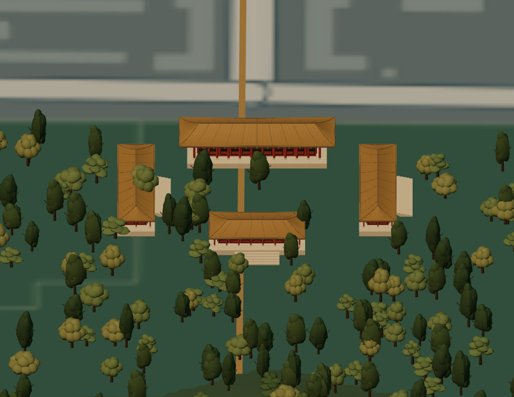

局部图由Chromium调用实际 `createCity` 渲染，1100×850；以寿皇殿模型中心向南4单位为观察点，近景正交纵向视野23单位、相机相对观察点 `[0,28,34]`，俯视27单位、相机偏移 `[0,100,0.001]`。共享配房布局保持原建筑位置、旋转与尺寸，增加包含屋檐、前阶和亭台的植树禁入范围。树冠使用原有保守圆盘，不能据此判断实地逐树分布。

验证记录：

- 新增测试直接读取渲染建筑网格包络，修正前有建筑快照的用例发现27棵树的安全圆盘侵入建筑；无快照用例同样失败。修正后有/无快照两项均通过。
- `npm test -- src/scene/jingshanTrees.test.ts src/scene/jingshanTerrain.test.ts src/scene/forest.test.ts`：3文件6项通过。
- `npm run build`：通过，保留Three.js分块大于500kB的体积提示。
- 景山实际页面ready耗时8.5秒，pageerror/console error均为0；二维屋面生成；390×844无横向溢出。局部隔离渲染不作为无警告声明。
- `npx playwright test -g 'chapter|accessible'`：实际匹配1项，iframe返回及焦点测试通过；未声称本轮重跑完整E2E。
- 完整 `npm test`：97通过、5失败，其中中央绿地及太庙两项为5秒超时；这两文件与凹形建筑测试以 `--maxWorkers=1` 复跑后15通过、3失败。剩余3项是 `polygonBuildings.test.ts` 找不到 `mapped-concave-roof`，属于本轮景山修改之外的工作区问题，未修改其实现或断言。
- 来源ID/URL无重复、来源目录对应、全部数据清单大小和SHA-256一致。核验时来源57条（包括其他并行工作增补），本次景山修正无新增来源；未重新下载地图数据。

工作区包含并行未提交修改，本次没有创建混合提交。截图基准HEAD：`c1eb21cace3770f81d35214570624930e7268f52`，不能代表整个截图工作区已提交；以以下源码指纹补充标识：

- `src/scene/jingshanLayout.ts` SHA-256：`d648cbac628968f283a49f8d52f686f68794811508218bd71545ea0060ce67a6`。
- `src/scene/jingshanTrees.test.ts` SHA-256：`6f2447dcc6464fc06ced9e3004357d067decf43cc7d4642d5e2a7a331e957145`。
- `src/scene/architecture.ts` SHA-256：`7462d372d8c8633b8465f40beb07d72cc73eebe9f53ceb67b384fcb8ca5574b9`。
- `src/scene/forest.ts` SHA-256：`f25e4df3f075a3924625da63d51ef4fa082150e4c12f4a7ad1c462f13422cabf`。

本轮新增景山图册链接均存在。全研究目录链接扫描另发现并行增补所引用的 `greenery-review-2026-11-14.md` 尚未落盘；未将全目录链接检查记为通过。代码块内Overpass查询坐标不是Markdown文件链接，排除在断链判断之外。

最终应用检查：Chromium无头浏览器，1440×1000视口，`/#/site/zhengyang`，约10.5秒达到scene ready，随后等待相机过渡并截图。二维正阳门屋面SVG路径长度875；390×844下无横向溢出；页面异常与console error均为0。由于前一次15秒等待曾超时，此次诊断脚本允许最多60秒观测，没有修改E2E的默认断言，也没有把这次手动观测称为全套E2E通过。独立入口另以 `/chapters/{north,central,south}/index.html` 逐一打开，均HTTP 200、显示对应“分区接入示例”标题、具有1个返回按钮；这些是集成示例，不是队友最终章节。

## 2026-11-14 · 广场与端门周边绿化核查

以下均为本项目模型截图，非现场照片或最终比赛验收。基准提交 `c1eb21cace3770f81d35214570624930e7268f52` 上的未提交工作树；同一目录还有其他会话的并行改动，因此本轮未将其一并提交。

| 截图 | 观察与限制 |
| --- | --- |
| [广场两侧低矮种植带](greenery-square.png) | 原贯通乔木线已移除，两片种植带位于广场北半部内侧；轮廓及装饰为示意，不是当日花卉方案 |
| [社稷坛外围柏林](greenery-shejitan.png) | 从地标固定偏移树线改为内坛围墙外围的局部柏林，保留入口；尚非全园完整植被图 |
| [端门庭院与相邻绿化](greenery-duanmen.png) | 端门阔叶树独立于两侧坛庙柏林，中央通道留空；单株位置/树种仍为解释 |
| [端门窄屏](greenery-mobile.png) | 390×844实际页面，未出现横向溢出；不等于手机GPU实机性能测试 |

桌面截图：Chromium无头浏览器、SwiftShader、1200×850、deviceScaleFactor=1，使用系统“减弱动态效果”偏好，直接打开实际页面对应地标路由。桌面三张与窄屏均完成截图，pageerror及console error为空；Tab后焦点落在链接。首轮1440×1000且启用动画的第二张截图超过30秒，未当作通过；后续上述独立检查成功，不提高仓库默认测试阈值。

实际验证：

- `npm test -- src/scene/centralGreenery.test.ts src/scene/forest.test.ts src/scene/squareGround.test.ts src/scene/environmentDetails.test.ts src/scene/bake.test.ts --maxWorkers=2`：5文件12项通过。涵盖水面/建筑树冠避让、坛庙与中央通道分离、广场铺地内低矮绿化及既有场景回归。
- `npm run build`通过；仍有Three.js分块超过500kB的体积提醒。未宣称整仓所有单测/端到端套件本轮全绿。
- 独立Playwright交互检查：二维图存在2片种植带；390×844无横向溢出；北段iframe返回并将焦点还给品牌链接；无pageerror/console error。
- 来源登记57个唯一ID/URL，新增8项均能对应来源目录与专题记录；本轮相关研究文档相对链接无缺失，`git diff --check`通过。未变更地理快照。

详细依据、来源访问限制和未完成项见[绿化核查](../greenery-review-2026-11-14.md)。以下SHA-256标识本轮实现，不能替代最终交付提交号：

- `src/scene/centralGreenery.ts`：`015ee75e20b68f12eb95b0acb87f5e6dec00ab94fbe40ff8ac710d447494e4df`。
- `src/scene/forest.ts`：`fa4e9117dc04040a454a5658ccae5f69e853d8a064120f62ec1ae71171dd230a`。
- `src/scene/civicLayout.ts`：`877f8e4e074fb2f25dc9168053059562784653d104dcc0848e9b3c4e48eaf246`。
- `src/styles.css`：`5d50d818a501e0432f6b7d2c07cc90123c61e39f9b568f1bc14a7ed16647b366`。
- `src/scene/centralGreenery.test.ts`：`6b49c605859127f42db19dbdb6f79b30f5c0a2f6ecbfdb304b29fe0c76aa2443`。

## 2026-11-14 · 故宫屋面与台基纠错

本轮新生成的自制模型截图，非实景照片。基准提交 `c1eb21cace3770f81d35214570624930e7268f52`，工作分支 `codex/axis-atlas`，当前共享工作树含其他任务未提交改动；没有将其一并提交，也不称最终比赛验收。

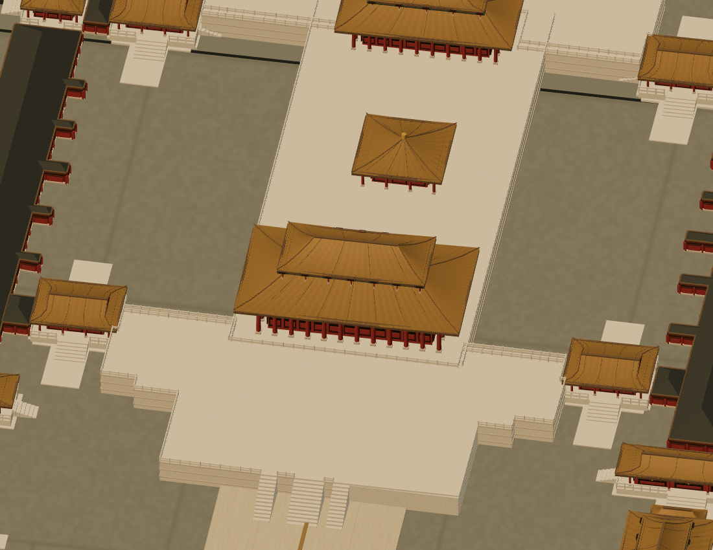

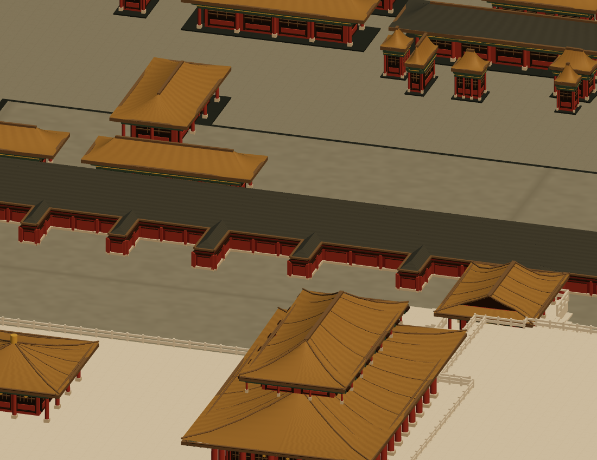

局部渲染调用实际 `createLandmark`、`createMaterials` 和 `bake`；1100×850视口。修正前图以way638449433的模型包络为中心、正交跨度16；修正后近景以太和殿包络为中心、跨度16，共用台基概览跨度25，两者相机相对目标均为 `[6,32,36]`。目标中心不同，不能将前后图当成逐像素回归。灰顶详情以院墙6为中心、跨度9、偏移 `[-26,12,8]`。示意连接台面宽度、栏杆数量、侧门核心宽深和墙面分格不构成测绘认证。

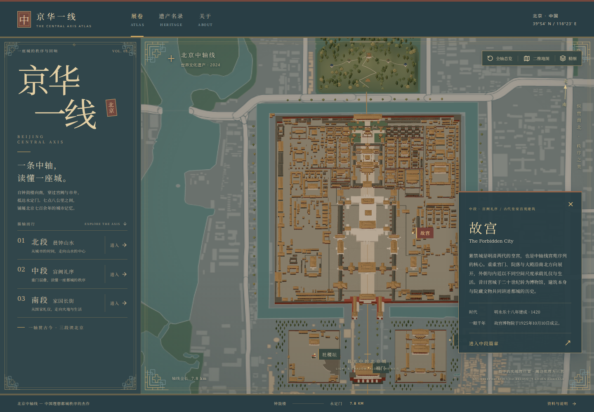

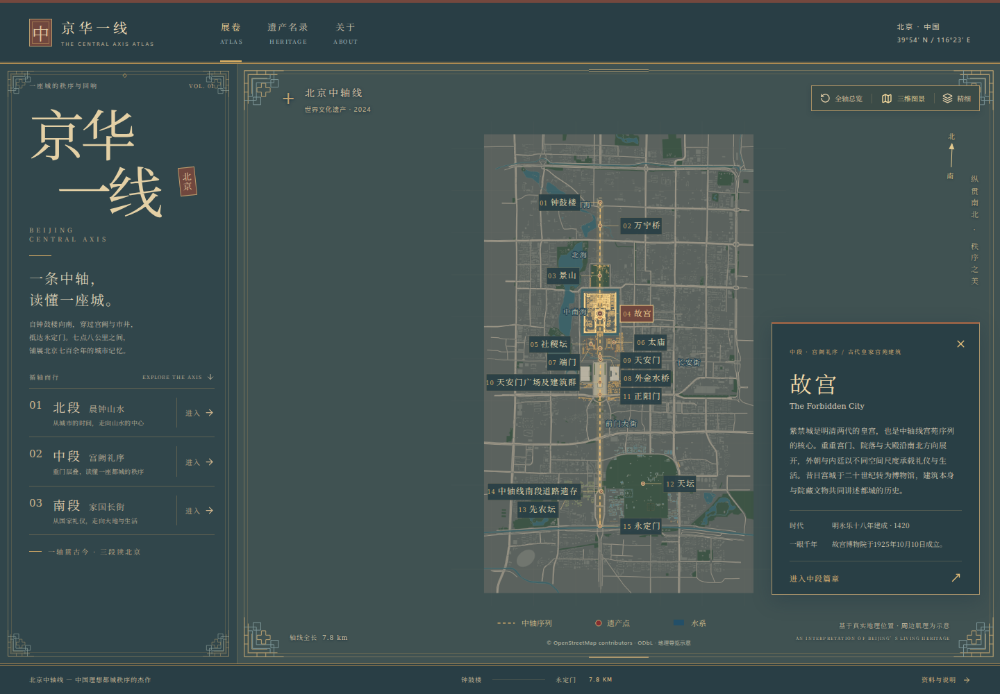

实际应用检查：Chromium、1440×1000、`/#/site/forbidden-city`；等待场景ready和详情标题后截图，相机可能仍在过渡。二维故宫屋面路径生成，390×844下横向溢出为false，页面错误和console error合计0。隔离渲染有Three.js重复导入提示和软件GPU ReadPixels提示，未声称零警告。

实际验证：

- 故宫及凹形屋面5文件22项通过；最后一次执行 `npm test -- --maxWorkers=2 src/scene/palaceMassing.test.ts src/scene/palaceArchitecture.test.ts src/scene/palaceWallDetails.test.ts src/scene/polygonBuildings.test.ts src/scene/polygonRoof.test.ts`。
- 全量默认并发首轮96/99通过，3项为5秒超时；限制worker为2后 `npm test -- --maxWorkers=2` 的25文件99项全部通过，没有放宽测试超时或删减断言。
- `npm run build`通过，保留Three.js包超过500kB提示。
- `npx playwright test`首轮2/5通过；后续重建并串行复核4/5通过：总览/窄屏、广场详情、二维地图、iframe返回和焦点通过。Shift旋转后普通拖动仍在60秒处超时，未完成该项，不宣称全套E2E通过。
- 来源ID与URL去重、目录对应、研究文档相对链接、7份既有数据快照的字节数/SHA-256及 `git diff --check` 通过。

来源、对象误判和替换理由详见[本轮研究记录](../palace-roof-review-2026-11-14.md)。以下源码指纹记录局部截图生成后的版本；共享总装文件可能由并行工作继续改变，最终提交号仍待交付时补齐。

- `src/scene/palaceMassing.ts` SHA-256：`6b47c33e7d95652b32448f7056bcb85728ced759c40849b4b610a36ef19bf177`。
- `src/scene/palacePlatforms.ts` SHA-256：`31d60bbc439c79758fec39614b02acf2c6568fac2a9f333e33618d2c8300a9a6`。
- `src/scene/polygonBuildings.ts` SHA-256：`2f5779cfe140525f0113a3dca3fe30b192b88ae4d6f867f0438ea50d3039abdb`。
- `src/scene/polygonRoof.ts` SHA-256：`d1f1924b8c911cbb4a8cc8126680aad876e49fa95ac15bcfcb407906009e6d8b`。

## 2026-11-14 · 景山五亭细化

以下均为项目模型校核图，非真实建筑照片。生成于2026-11-14，基准提交 `c1eb21cace3770f81d35214570624930e7268f52` 的未提交工作树；工作区同时存在其他改动，以关键文件哈希补充定位。不是最终参赛发布验收。

同一1100×850视口、38单位正交视野、目标GCJ-02 `[116.3969,39.9251]`、相机相对偏移 `[8,13,34]`；运行实际 `createCity` 的完整场景，包含现有植被和受园界/道路约束的山体。观察：旧亭的细柱和尖锥顶被有区别的三檐方亭、双檐八角亭与圆亭替换，侧亭的夸大高度减少，原亭位保留。

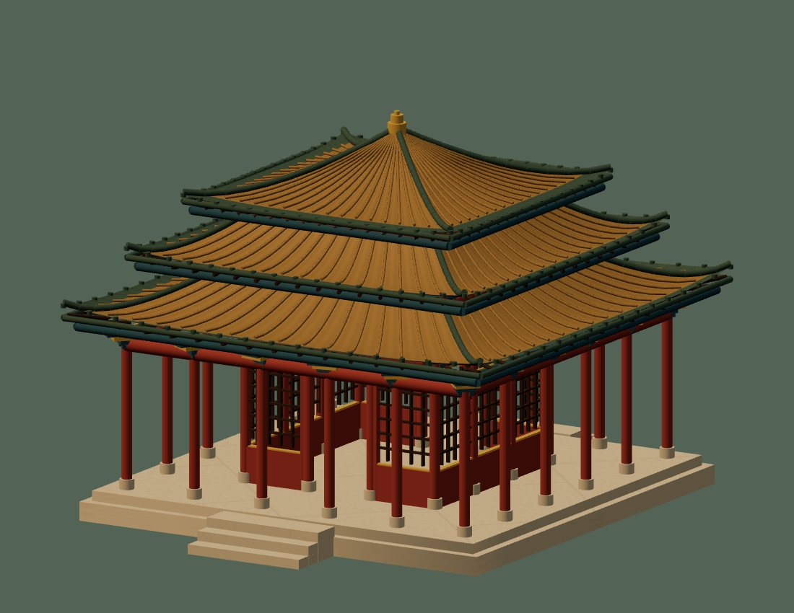

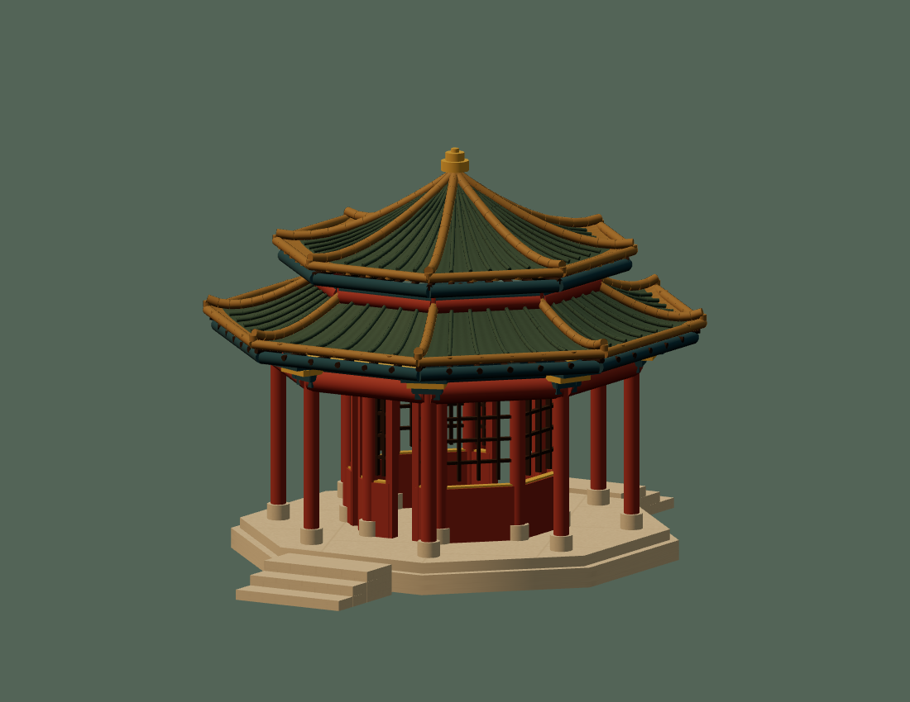

近景均1100×850，分别以万春亭、辑芳亭、周赏亭生成模型的包络中心为目标，正交视野2.65/2.05/1.95单位，相对偏移 `[3,1.4,5]` / `[3,1.1,5]` / `[3,1.1,5]`。使用真实 `createLandmark`、本地 `createMaterials` 与 `bake`；检查曲面重檐、剪边、瓦条、柱廊、简化斗拱、槛窗及石台阶。孤立渲染脚本出现多份Three.js导入及软件GPU ReadPixels性能提示；不将该脚本描述为完全无警告。

实际 `/#/site/jingshan` 1440×1000页面，ready约3330ms后检查；切换二维地图成功（屋面路径15703字符）；390×844无横向溢出，pageerror/console error为0。相机过渡截图只用于页面运行校核，不据此判断建筑测量精度。

回归：`npm test -- --maxWorkers=1 src/scene/jingshanPavilions.test.ts src/scene/jingshanTrees.test.ts src/scene/jingshanTerrain.test.ts src/scene/bake.test.ts`，4文件10项通过。覆盖亭型/高度、32柱、开敞门道、曲面及裙檐中孔、宝顶承接、树冠避让、山体道路约束与几何合批；没有运行全套E2E。最终几何修改后再次执行 `npm run build`，TypeScript与Vite构建通过（29.52s）；保留Three.js分块超过500kB的体积提示。`git diff --check`通过；研究目录本地链接及4个新增来源ID引用一致，来源总数65、ID与URL无重复。

来源为 `JING-WANCHUN-PARK`、`JING-JIFANG-PARK`、`JING-ZHOUSHANG-PARK` 与 `JING-DPM-P38`。图中檐出、层高分配、斗拱叠块和窗格是模型解释，不是节点测绘或完整彩画复原。PDF完整书目与现状立面仍待补。源码指纹：
- `src/scene/jingshanPavilions.ts` SHA-256：`2603e3cf0a7f5543dd776a7091642e8c915c41bb6f88968e4830c18d0ff26b67`。
- `src/scene/architecture.ts` SHA-256：`9d7d7b3b556fb32160a2a1125af65e390a585687b1dee73dbc328bd9a7bb58b0`。
- `src/scene/jingshanLayout.ts` SHA-256：`62b2cd412b94cd15c3879c18581bc417583fcfcf2b2caa7b1ea772f5a7b49013`。
- `src/scene/jingshanTerrain.ts` SHA-256：`8b2b73c2b0a47193b2fe91347b6b754f36c0046695c2d1be1a652023078fc812`。
- `src/scene/materials.ts` SHA-256：`f7d31be37187613f37360915451b3ba8029ebbd84284bb02ec08abfa62faa814`。

## 2026-11-14 · 故宫西北部围墙补全

2026-11-14生成的项目模型校核图，非真实建筑照片。基准提交 `c1eb21cace3770f81d35214570624930e7268f52` 上的未提交工作树；同时存在其他未提交工作，以文件哈希标识本次关键源码。不是最终比赛验收版本。

同一1100×850视口、51单位正交视野；WGS84目标 `[116.3881,39.9191]` 经既有GCJ-02转换和场景投影，相机相对偏移 `[0,70,18]`。实际 `createCity` 加载本地数据后渲染。观察：寿安宫、英华殿周边与建福宫附近原先连成空地的院落恢复分隔墙；墙线沿源折线连接，未在每个庭院外接框画封闭矩形。场景中的其他未完成细部不在此轮验收范围。

同一目标和视口，正交相机相对偏移 `[0,100,.001]`；检查新增线与源地图、现有建筑及旧墙的相对关系。四个视图为完整场景的局部镜头，不能证明现实中没有其余缺墙。

实际 `/#/site/forbidden-city` 页面1440×1000，ready约3395ms，console error与pageerror均为0。切换二维地图后屋面路径265420字符、院墙路径113848字符；390×844无横向溢出。`palaceWallRuns` 在该快照与建筑裁切条件下输出464段、涉及179个源way；这不是179座院落，也不等于原始189条围墙全部完整呈现。

验证命令：`npm test -- --maxWorkers=1 src/scene/palaceWalls.test.ts src/scene/wallRuns.test.ts src/scene/palaceWallDetails.test.ts src/scene/palaceMassing.test.ts src/scene/bake.test.ts`，5文件15项通过。检查西北关键墙线、源折线溯源、宫界、真实凹形建筑裁切、去重、入口、既有灰顶墙细节及宫殿台基/合批回归。未运行全套E2E。`npm run build`通过（29.17s），保留既有Three.js分块超过500kB提示；`git diff --check`通过。10项数据清单的大小/哈希与189条原始围墙坐标逐一核对通过，65个来源ID及URL无重复，研究文档本地链接存在。

地理证据沿用 `GEO-OVERPASS` / `GEO-OSM`；专门查询的原始响应、历史请求时间、服务器基准时间、WGS84坐标、ODbL署名和哈希均已归档。默认墙身尺寸、石脚、灰瓦帽、入口宽度和防穿插余量是导览模型参数，非现状逐墙测绘。源码指纹：

- `src/scene/palaceWalls.ts` SHA-256：`721108b44696eecf9a816cb47a8f1b898fff844e8ecc14517efd090e9b275c80`。
- `src/data/palace-walls.json` SHA-256：`0adb31970e0dad46c528de5985702c04bab0e4e022e47d0d48d3d1a8bd45fcee`。
- `src/scene/architecture.ts` SHA-256：`d5e14f5910f2e7d3399f00dbc43be3cfa11903647cc077f107485f9134f3c406`。
- `src/components/FlatMap.tsx` SHA-256：`de8048b423025373d72477a13fb7c61e68ababb59a9c91d3ba9258af535a2a63`。

## 2026-11-14 · 天坛与景山铺地和道路连接

以下均为本项目模型截图，桌面1440×1000、窄屏390×844。桌面修正后截图临时隐藏详情面板以便观察；院落近景使用实际场景拖动与缩放。道路折点、路宽和院内硬铺比例为导览示意，未以这些截图证明现状准确性。

- [天坛修正前](tiantan-paths-before.png)：只有丹陛桥，斋宫内仍为草地。
- [天坛路网修正后](tiantan-paths-overview.png)：横向和侧向通路、附属院落接入。
- [斋宫院落近景](tiantan-courtyard-after.png)：护河内铺地、三向入口连接及树冠留白。
- [景山修正后](jingshan-paving-after.png)：寿皇殿与绮望楼铺地、前后山通路及东西登山连接。
- [天坛窄屏](tiantan-paths-mobile.png)：布局与浏览器检查，非全园视觉验收。

证据、实际验证结果与限制见[本轮记录](../tiantan-ground-review-2026-11-14.md)。

## 2026-11-14 · 天坛北部、西侧和长廊连接续修

后续截图显示首轮仍遗漏北门两侧、西门附近与西南配房，长廊支路也不对齐。以下是项目模型校核，非实景或历史参考照片，亦非最终比赛验收。

| 检查区域 | 修正前 | 修正后 |
| --- | --- | --- |
| 北门两侧和北天门 | [前](tiantan-north-before.png) | [后](tiantan-north-after.png) |
| 西北独立排房 | [前](tiantan-northwest-before.png) | [后](tiantan-northwest-after.png) |
| 西门、院落与小建筑 | [前](tiantan-west-before.png) | [后](tiantan-west-after.png) |
| 西南配房 | [前](tiantan-southwest-before.png) | [后](tiantan-southwest-after.png) |
| 神厨、宰牲亭及长廊 | [前](tiantan-corridor-before.png) | [后](tiantan-corridor-after.png) |

Chromium独立校核页使用实际 `createLandmark`、`createForest`、`createMaterials` 和 `loadCityData`，1500×1000画布；正交相机相对目标 `[0,85,58]`，目标和垂直视野依次为 `[18,0,-56]/74`、`[-54,0,-37]/50`、`[-62,0,0]/61`、`[-45,0,46]/49`、`[38,0,-21]/23`。修正前由浏览器路由替换为提交 `aa7ba4f` 中的原铺地模块，其他模块和相机保持一致。基底是校核用平面，灯光独立设置，故与主应用色调不同；仅校核铺地、路网和植被相对关系。

观察：北西遗漏群组已有硬地和接路；北附属院落短通道接入长廊，没有旧版横穿廊身的长支路；完整树冠避让新铺装。铺地范围与连接是概览解释，实地路缘、院内绿地、精确门洞和树池仍待补证。主应用另有[桌面](tiantan-access-app.png)、[390×844窄屏](tiantan-access-mobile.png)运行截图；实际测试结果及版本边界见[续修记录](../tiantan-north-west-review-2026-11-14.md)。
