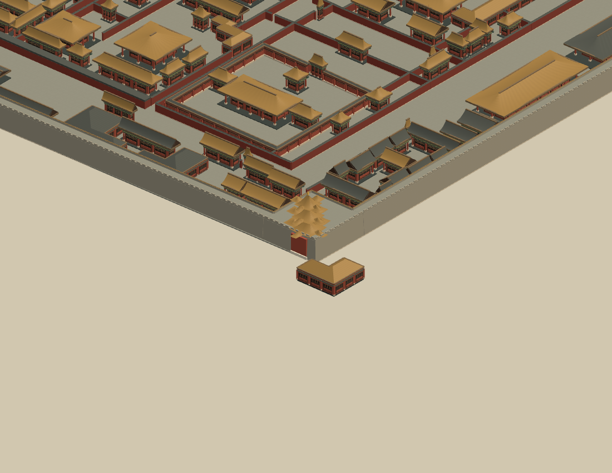

# 故宫屋面、台基与灰顶廊墙复核

复核日期：2026-11-14。本记录针对用户提供的两张项目截图。它们是本项目模型画面，不是历史建筑照片。本轮尚属工作树修正，不是比赛最终验收。

## 角楼比例与抱厦补正

用户最新截图指出角楼体量过大且屋面粗糙。复看截图可见原模型是被放大的方形底座叠三层宽方顶，与角楼的方向性抱厦平面不符。直接复核故宫博物院 `PAL-CORNER-TOWER` 正文：中心方亭每边8.73米，外侧两面抱厦进深1.60米，内侧两面3.98米；馆方记载总高27.50米及三重檐复合歇山屋顶。

按项目10米/场景单位改为中心方亭加四向抱厦的非对称十字布局，抱厦面宽及内外向进深依上述数字缩放；总平面外包络约14.31米见方。四角仍各保留一座。三层屋面采用交叠歇山体的导览近似，并降低抱厦屋面尖耸感；屋脊交接、斗拱、檐口构件、石栏和角部节点未作复原。馆方网页文字支持关键尺度和屋顶类别，但本轮未归档或转载馆方配图，故不能把交叠几何称为馆方图像校准或测绘成果。

实现：[palaceCityWalls.ts](../../src/scene/palaceCityWalls.ts)；尺度回归：[palaceCityWalls.test.ts](../../src/scene/palaceCityWalls.test.ts)。模型截图为本项目中间检查画面，不是现实照片或验收证据：

验证：角楼及城垣定向测试 `palaceCityWalls.test.ts` 6项通过；隔离浏览器渲染 `pageerror` 为0。完整构建 `npm run build` 通过，保留Three.js分块超过500kB的既有提醒。同期院墙测试仍有既存几何断言与宫墙外建筑裁切预期不一致，未据此声称全套围墙/角楼验收通过。

## 问题与被替换的解释

第一张截图显示不规则建筑屋面出现圆滑鼓包；原算法使用到线段的欧氏距离抬高、统一截平并平滑法线。最初只改成有折线的坡面，仍把带台阶凸出的月台轮廓当作建筑屋面。用户第二次指出不符现实，这个反馈纠正了研究对象识别：不能把所有 `building=yes` 都当成瓦屋顶。

旧 `polygonBuildings.test.ts` 曾要求三个台基way有坡屋顶；这个断言随错误解释一并撤销，由 `palaceMassing.test.ts` 的“台基不得出现瓦屋面或门窗”检查替代。普通凹形院落建筑仍检查屋面不封院。

## 证据与各自能支持的内容

- **馆方文字**：`PAL-TAIHE`于本次联网正文复核，记载殿前丹陛/月台、三层汉白玉基座和8.13米台基；`PAL-BAOHE`确认主殿的重檐歇山形式；`PAL-TAIHEMEN`确认其与廊庑的空间关系。这些文字支持区分石台与屋面，不直接标注OSM编号。
- **共用台基**：新增 `PAL-THREE-TERRACES` 正文把三大殿共用台基称为“土”字形；`PAL-THREE-PLAN` 的检索摘录称“工”字形。保留两种描述，本次只采用三殿共用三层石台这一共同点，不按字形称谓推算测绘边界。后者原件、页码和正式出版信息待补。
- **两侧楼阁**：新增 `PAL-TIREN`、`PAL-HONGYI` 正文分别记载25米和23.8米、上下两层、腰檐/平座与顶部庑殿屋盖。不能把这种楼阁做法简单称为主殿重檐等级。
- **地图几何**：读取既有 `public/data/buildings.json` 和压缩原始OSM，确认相关无名way只标 `building=yes`，没有可证明是屋顶的属性。轮廓的三个阶梯凸出、与主殿相邻的关系参与对象判读；OSM仍是未更改的原始快照。
- **视觉材料**：复看既有本地太和殿/保和殿参考拼板，支持石台与殿身分离的可见层次。拼板本轮未补足逐张版权和原始链接，因此不新增“已核验照片”条目，也不把它作为运行时资产或比赛可转载图片。新增官方资料只提取正文，未复制原图。

## 实现与解释边界

1. `src/scene/palaceMassing.ts`对7个地图way显式作石台解释：`638449433`、`638449259`、`638449270`、`638467894`、`638460864`、`638460865`、`638981252`。前两组采用三台高度；后一个内廷通道/台基采用0.20场景单位的示意高度，仍待专门平面校核。**编号到对象的匹配是模型判读，不是馆方数据。**
2. `src/scene/palacePlatforms.ts`将南北平台的凸出部分表现为阶梯；三层线脚、栏柱间距和15步采样是比例概化，不是实测台阶数。三殿之间的连接台面由两个主殿位置推导，是明确标记的示意补建；不把它说成完整的真实三台边界。
3. 中左/中右/后左/后右门、左翼/右翼门、四座崇楼及体仁/弘义阁共12个way拆成地图基底与矩形屋面主体。主体由局部断面排除窄小台阶凸出；宽深收缩、侧门高度及缺少专门资料的屋顶形式是导览解释。两阁用现有分层木构表达楼层和腰檐，平座栏杆与精细节点未完成。
4. 院墙/侧墙名称分支补入柱墩、石基、檐枋与墙面分格，保留灰顶及封闭墙体。用户称它为连廊，而地图属性称院墙，当前材料不足以逐段改成开敞柱廊；本次不凭名称冲突虚构门窗。完整廊庑类别、材质颜色及开敞方向仍需逐段照片核验。
5. 真正保留为凹形房屋的外围建筑使用 `src/scene/polygonRoof.ts`：由分段线性坡面在交线处裁分，去除圆形转角、统一截平与跨脊平滑。该计算是示意折面算法，不是古建结构计算，也不声称生成了测绘直骨架。
6. `FlatMap.tsx`同步把石台放入非屋面图层、侧门等用矩形屋面核心；`cityPlan.ts`中的石台底色同步改为石色。坐标系、原始OSM轮廓、分区iframe契约没有修改。

## 验证记录

本轮先执行故障回归：圆角、平顶截断、屋脊法线3项失败；灰顶侧面缺失1项失败；台基与侧门分类8项失败。完成相应修正后，5个相关测试文件22项通过，生产构建通过。后续全量、浏览器结果见[本轮校核图册](figures/README.md#2026-11-14--故宫屋面与台基纠错)。这类测试证明渲染规则，不证明历史形制已完整复原。

当前共享工作树还有其他任务的未提交修改，本轮不将它们打包提交。最终比赛版本仍须补最终提交号、固定视角截图和完整验收。

## 台沿栏杆缺口补正

用户后续截图显示太和殿月台长边及侧向转角没有栏杆。生成器用未裁切轮廓建栏杆，并在任一端点越过台阶切线时丢弃整条边；略倾斜的地图轮廓因此连带失去应保留的台沿。

本次再次直接下载 `PAL-TAIHE` 馆方正文，核对三层基座“周围环以栏杆”的记载。未新增来源，未下载或采用外部照片。栏杆的具体落点仍依赖既有 `GEO-OSM` / `GEO-OVERPASS` 轮廓和模型裁切，不是馆方测绘。

`palacePlatforms.ts` 改为沿最上层实际裁切轮廓生成栏杆；在台阶行程中段提取凸出阶梯的侧线，并投影至台阶顶端，仅扣除各台阶入口。该中段判读适用于当前南北平台的三个阶梯凸出，是模型算法，不是通用古建测量方法。保持台阶数、平台体量与栏杆样式；南北两处均回归检查。共用连接台面仍保留两端通行开口。具体截图与本次验证见[栏杆补正图册](figures/README.md#2026-11-14--故宫台沿栏杆补正)。

## 太和殿前台阶对称补正

用户截图指出太和殿前三级阶梯的宽度与间距视觉不对称。已有实现把一整圈地图轮廓逐层平行裁切，局部节点疏密和边缘角度会直接改变三组踏步。改为保留地图轮廓所确定的平台范围，在估计的台阶起点裁出平台主体；三组楼梯作为独立石构生成。沿既有投影轮廓在踏步行程中段提取三处横向位置，以中间梯为中心，统一宽度、间距、进深、步数和高差；台沿栏杆继续按三个通行开口裁切。

这是导览模型的对称化表达，不把地图描绘差异解释为真实建筑不对称或测绘误差。南北平台采用相同规则；既有OSM轮廓、坐标、投影和官方文字来源不变，精确梯宽、间距、步数及现状节点仍待测绘资料。实现与检查见 `src/scene/palacePlatforms.ts`、`src/scene/palacePlatforms.test.ts` 和[本轮局部校核图](figures/README.md#2026-11-14--太和殿前台阶对称补正)。

该阶段针对台阶文件7项测试全通过；局部Chromium校核 `pageerror=0`；`npm run build` 通过，仍提示Three.js chunk超过500 kB。关联五文件回归集合共33项，32项通过；唯一失败是 `palaceArchitecture.test.ts` 的中和殿仍要求使用原POI横向坐标，与当前工作树已有的中和殿轴线投影布局不一致。上述检查没有验证逐级踏步及平台接合；用户后续侧面反馈证实阶梯脱台，该阶段不能视为接合验收通过，由下节更正。

## 台阶脱离平台的侧向复核与修正

2026-11-14用户指出侧面可见台阶与平台断开。实际Chromium侧面、斜侧面复现：每块踏步宽度为一级，但其中心位置每级只移动半级，15级楼梯只延伸至预定进深的一半左右，最高一级无法抵达平台。此前比较三组楼梯包围盒只证明彼此相同，不能证明通往平台的表面连续。

修正每级中心为完整步距的半格位置，使相邻立面接触、最高级后缘抵达平台裁切线；对归一化梯宽下原地图台沿的局部凹折，从裁后平台横断面推导连接面，以0.02场景单位的内部搭接避免裂缝，并从该连接范围扣除原台沿栏杆。该搭接是渲染参数，不是新增实测尺寸；`PAL-TAIHE` / `GEO-OSM` / `GEO-OVERPASS` 仅本地复核引用边界，未新增网络核验、照片、数据快照或坐标变换。

新增回归在南北两处真实轮廓上检查每级前后边缘接触、逐级行走高度，以及梯宽左中右三条路径跨越最高级至平台的表面连续和栏杆避让；同时保留等宽与镜像间距检查。图册保留[同角度失败与修正对比](figures/README.md#2026-11-14--台阶脱台侧向复核)，另外检查实际 `createLandmark/bake` 总装；初轮正面截图不再作为接合完成证据。精确梯宽、级数、栏杆节点仍待测绘。

实际验证：`palacePlatforms`（9项）、`palaceMassing`、`palaceWallDetails`、`palaceFootprintClipping` 四文件共24项通过（2个worker）。生产构建首次遇到共享工作区 `palaceGates.test.ts` 引用尚未导出的函数；该文件随后由并行工作补入导出，重跑 `npm run build` 通过，仍有既有Three.js超过500kB提示，本次未修改该门楼模块。Chromium南北侧面/斜侧面与实际总装均无pageerror；主页面1440×1000和390×844检查pageerror及console error均为0，窄屏无横向溢出。未重跑全量单测或完整E2E。

研究校验时共享工作区已含其他新增来源，共71条ID/URL无重复、均出现在目录，本轮未添加来源；所检查研究文档的本地文件链接有效，11个既有地理快照的大小和SHA-256与清单一致。基线HEAD `cc0ed8d55275c06e2b3542862e834acf157314d0` 加共享未提交修改；台基源码SHA-256 `75e5204f46e27e82edbdf524d2288bed0af51a687c4404d534c244ceed60a9a2`，不能代替最终参赛提交号。

## 中和殿朝向与中心补正

用户俯视截图指出太和殿后方建筑歪斜。代码与俯视渲染确认中和殿使用零旋转，未采用相邻殿宇的宫城建筑朝向；其中心直接取高德POI标签，存在相对三殿连线的横向偏移。

本次直接下载并复核既有 `PAL-ZHONGHE`：文字支持该殿位于太和殿与保和殿之间、平面正方形、单檐四角攒尖。它不提供方位角或建筑中心坐标。沿用 `GEO-OSM` / `GEO-OVERPASS` 本地建筑轮廓求太和殿与保和殿中心，保留原POI沿两殿连线的纵向位置，将横向偏移投影回该连线；无完整轮廓时用既有 `building-layouts.json` 中心兜底。原 `B000A9PJ70` 坐标保留为原始标签证据，不能再描述为未经调整的模型中心。

`palaceArchitecture.ts` 提供二维/三维共用中心、方形包络及 `precincts.ts` 宫城建筑方向。`architecture.ts` 将方向施加到整个中和殿分组；`FlatMap.tsx` 同步旋转屋顶轮廓和脊线。原26.5米方形包络及高度参数不变。这是导览模型对齐，不是新测绘；共享台基仍为概化连接，逐个栏杆节点、台阶和实际殿身位置仍需测绘资料。

回归覆盖真实建筑轮廓、缺轮廓兜底、三维装配及二维共用布局；本轮截图和实际结果见[中和殿校核](figures/README.md#2026-11-14--中和殿朝向与中心补正)。

## 英华殿东侧院墙走向及衔接补正

用户先指出楼旁围墙没有接住，随后圈出英华殿院落东侧长墙偏斜。浏览器局部场景射线命中墙线41657475、其南接42509088；相邻横墙42311505共享节点。初始将问题猜成灰屋面不准确，本次以用户澄清与模型要素命中为准。

两项不同修正：移除建筑裁切默认0.06场景单位退距，让独立墙线抵达建筑轮廓；保留真实入口节点及原开放墙线断点。对圈选长墙，保持41657475北端转角，取已有院墙面156196336东侧长边方向，将长墙两个节点及相邻横墙交点投影到同一条平行线上；42509088南端建筑连接点不移动，以一段短转折接回校正线，避免重新开缝。

地图材料沿用GEO-OVERPASS/GEO-OSM的本地快照，没有重新联网。本次小于2.5米的节点调整是用户要求的导览显示取舍，不证明源地图错误或真实墙线严格平行；原始WGS84、快照查询、数据清单均不改。现有内墙高度、灰顶、开口宽度仍为概化参数。二维和三维共用校正后的palaceWallRuns；其他墙线仍沿源坐标。源码/检查见palaceWalls.ts与palaceWalls.test.ts，具体结果见[图册](figures/README.md#2026-11-14--英华殿东侧院墙走向补正)。

## 平台与两侧灰顶回归修复

用户新截图显示白色月台再次变成带门窗的金色屋面，随后指出两侧原深灰长顶也变黄。浏览器同视角重现问题。新增宫墙边界裁切每轮把轮廓顶点顺序平移一位，虽然几何没有改变，调用方的逐顶点比较仍触发通用房屋分支，提前跳过台基、侧门和灰顶分类。不是既有7处台基ID丢失，也不是新证据推翻旧判读。

`palaceCityWalls.ts` 在轮廓全部位于当前裁切边内侧时跳过该轮，保持未变轮廓的顶点序列；实际越界仍裁切。既有 `palaceMassing.test.ts` 修复前7处石台和1处侧门失败，修复后通过；新增裁切测试先出现2项顺序失败、1项真实裁切通过，修复后3项全部通过。`palaceWallDetails.test.ts` 补4段屋面必须使用原深灰材质的断言。浏览器通过仅对本地模块恢复旧裁切代码进行对照：4段灰顶修复前均为false，修复后均为true。

2026-11-14再次直接下载 `PAL-TAIHE` 官方正文，核对月台、三层汉白玉基座及周围环栏；未复制馆方图片、未增加来源。源轮廓、台阶尺寸、栏杆参数、两侧灰顶分支均沿用既有解释；不把本次修复描述为新增测绘或全宫复原。验证和模型截图见[图册](figures/README.md#2026-11-14--平台及两侧灰顶回归修复)。当前含其他未提交修改，不打包为本次独立提交；最终比赛版本仍需固定提交号。

## 午门、神武门衔接与门外对称修正

复核日期2026-11-14。门墙衔接不是前文角楼检查的自然验收结果；本节补做独立实现与验证。直接下载 `PAL-UMEN`、`PAL-SHENWUMEN` 官方正文，登记作者石志敏、朱庆征及可支持的形制、尺度。未转载配图，未增加来源；完整原始HTML的长期归档仍待补。

原午门墩台为实心轮廓，中央没有通道；雁翅楼附着通用殿台和多余台阶。原神武门按约115m地图外包络生成普通单层大殿，未区分门台、马道连接和上部门楼。现在 `palaceGates.ts`将台体与屋面分开：保留原地图轮廓/四处墙端共享节点，开中央三券门，补石质券边、铺面和低台沿；午门正楼使用馆方60.05×25m包络、两翼十三间及四端攒尖亭；神武门楼身核心按两侧接墙断面收窄，采用五间重檐庑殿组合。`palaceCityWalls.ts`把门台作为相邻体，取消接口横向垛墙与多余收分，午门接墙短坡接回9.9m墙顶。

神武门用户本轮截图红圈涉及门外两组房屋：小门房way/638741716、638741717和长廊way/42740569、42740572。每对原轮廓在门楼共同方向上取平均包络、前后中心和离中线距离，成对等距显示；同一函数供三维、二维底图及屋面使用。随后用户要求这一范围内的导览中轴线从中央券洞穿出，`axisRoute.ts`在门心前后各30m内沿中门方向通过，30—70m回接旧折线；主场景金线、宫内金线及二维共用。

严格区分：官方文字支持建筑形制和个别尺寸；地图支持既有轮廓与共享节点；对称化、导览线移位、券洞宽高、各檐标高与接墙短坡为模型解释。两掖门、钟鼓亭、详细马道及神武门栏杆节点未复原。原地图文件、POI、全图坐标变换不改，不能把成对显示称为现实建筑实测对称或官方路线。

本轮固定视角图和实际验证见[图册](figures/README.md#2026-11-14--午门神武门衔接与神武门正面对称)。当前共享树含其他改动，截图与源码指纹标识本轮状态，不冒充最终参赛提交。

本节最终验证：相关9文件38项，37通过；宫门与轴线5项均通过，剩余失败为城墙合批网格24个超过小于12的断言，未修改阈值。最后生产构建通过（1638模块；Three.js 539.69kB提示保留）。主应用补充脚本检查故宫详情ready、二维有效路径、390×844无溢出、中部章节返回与焦点恢复，pageerror/console error为0；修复异步载入前空轴线产生孤立M路径。全套既有Playwright为1通过4失败，涉及ready等待/总超时，未称全绿；鼠标点击二维按钮曾被详情遮挡，最终以键盘检查。来源、快照及版本边界详见上述图册，当前不是最终参赛提交。
